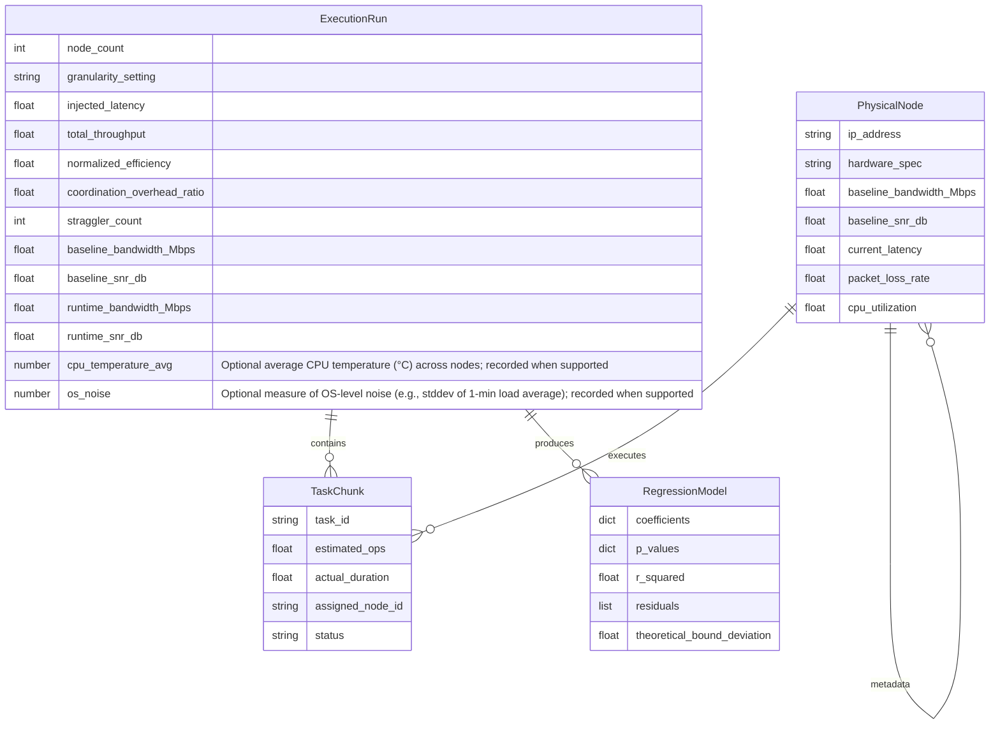

# Data Model: Mesh Network Supercomputer Using Pooled Idle Computing Resources

## 1. Entity‑Relationship Overview
Four core entities capture the full lifecycle from raw instrumentation to statistical output.

## 2. Entity Definitions

### PhysicalNode
| Attribute | Type | Description | Source |
|-----------|------|-------------|--------|
| `ip_address` | string | Unique IPv4 address | SSH discovery |
| `hardware_spec` | string | CPU model + RAM | `lscpu` / `free` |
| `baseline_bandwidth_Mbps` | float | Pre‑load bandwidth (iperf) | Local measurement |
| `baseline_snr_db` | float | Pre‑load SNR (iwconfig) | Local measurement |
| `current_latency` | float | Median RTT during run (ms) | `ping` |
| `packet_loss_rate` | float | Fraction of lost packets (0‑1) | `tcpdump` analysis |
| `cpu_utilization` | float | Avg. CPU % during run | `mpstat` |

### TaskChunk
| Attribute | Type | Description | Source |
|-----------|------|-------------|--------|
| `task_id` | string | Unique identifier | Scheduler |
| `estimated_ops` | float | Expected operation count | Benchmark config |
| `actual_duration` | float | Wall‑clock seconds | Node log |
| `assigned_node_id` | string | Node IP address | Scheduler |
| `status` | string | pending / running / completed / failed / reassigned | Scheduler |

### ExecutionRun
| Attribute | Type | Description | Source |
|-----------|------|-------------|--------|
| `node_count` | int | Active nodes in this run | Scheduler |
| `granularity_setting` | string | fine / medium / coarse | Config |
| `injected_latency` | float | Artificial latency (ms) | Config |
| `total_throughput` | float | Tasks / sec (aggregate) | Aggregation |
| `normalized_efficiency` | float | Throughput / Theoretical capacity (tasks/sec) | Derived |
| `coordination_overhead_ratio` | float | Handshake time / total time | Aggregation |
| `straggler_count` | int | Number of straggler events detected | Scheduler |
| `baseline_bandwidth_Mbps` | float | Avg. baseline bandwidth | Aggregated from nodes |
| `baseline_snr_db` | float | Avg. baseline SNR | Aggregated |
| `runtime_bandwidth_Mbps` | float | Avg. runtime bandwidth | Derived |
| `runtime_snr_db` | float | Avg. runtime SNR | Derived |
| `cpu_temperature_avg` | number | Optional average CPU temperature (°C) across nodes; recorded when supported | Sensor reading (`sensors`) |
| `os_noise` | number | Optional measure of OS‑level noise (e.g., stddev of 1‑min load average); recorded when supported | System load (`uptime`) |

### RegressionModel
| Attribute | Type | Description | Source |
|-----------|------|-------------|--------|
| `coefficients` | dict | Model coefficients (key: variable name, value: coefficient) | `statsmodels` |
| `p_values` | dict | P-values for each coefficient | `statsmodels` |
| `r_squared` | float | Coefficient of determination | `statsmodels` |
| `residuals` | list | Residual errors per observation | `statsmodels` |
| `theoretical_bound_deviation` | float | Empirical / theoretical efficiency ratio | Validation script |

## 3. Data Flow
1. **Baseline Capture** → `node_manager` records `baseline_*` fields.  
2. **Orchestration** → `scheduler` creates `TaskChunk`s, assigns to nodes, logs heartbeats & dropout events (`dropout_events.json`).  
3. **Instrumentation** → `instrumentor` streams `tcpdump` and `mpstat` outputs, writes per‑run CSVs to `data/raw/` and per‑node metadata JSONs (`physical_node_<ip>.json`).  
4. **Aggregation** → `analysis/regression.py` reads raw CSVs and node JSONs, computes per‑run metrics → `ExecutionRun` rows stored in `data/processed/execution_runs.csv`.  
5. **Statistical Modeling** → same script fits OLS, writes `data/processed/regression_model.json`.  
6. **Theoretical Validation** → `analysis/theoretical_bound.py` reads the model output, writes `data/processed/theoretical_bound_validation.json`.  

## 4. Data Hygiene & Checksums
- Raw files under `data/raw/` receive SHA‑256 checksums stored in `state/projects/PROJ-009-build-a-mesh-network-that-forms-the-larg.yaml`.  
- Derived files under `data/processed/` are new, never overwrite raw data.  
- All JSON/YAML artefacts are validated against schemas in `contracts/` before commit.

---

