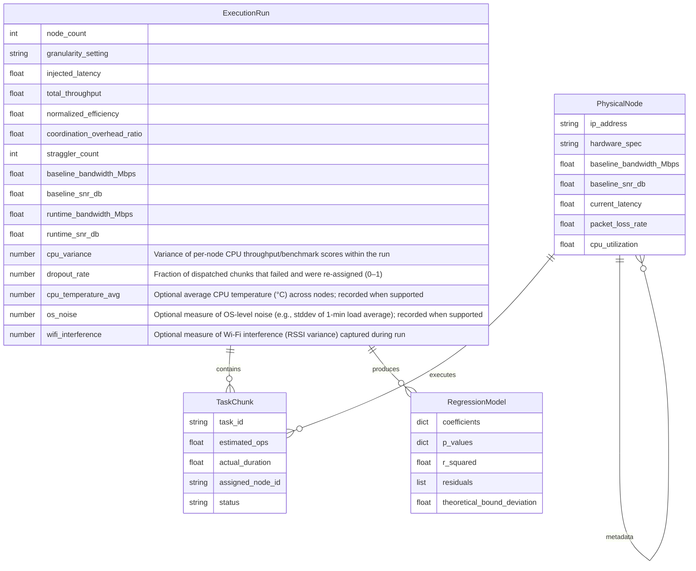

# Data Model: Mesh Network Supercomputer Using Pooled Idle Resources

## 1. Entity‑Relationship Overview
Four core entities capture the full lifecycle from raw instrumentation to statistical output.

## 2. Entity Definitions

### PhysicalNode
| Attribute | Type | Description | Source |
|-----------|------|-------------|--------|
| `ip_address` | string | Unique IPv4 address | SSH discovery |
| `hardware_spec` | string | CPU model and RAM | `lscpu` / `free` |
| `baseline_bandwidth_Mbps` | float | Pre‑load bandwidth (iperf) | Local measurement |
| `baseline_snr_db` | float | Pre‑load SNR (iwconfig) | Local measurement |
| `current_latency` | float | Measured network latency (ms) | `ping` |
| `packet_loss_rate` | float | Fraction of lost packets (0‑1) | `tcpdump` analysis |
| `cpu_utilization` | float | Avg. CPU % during run | `mpstat` |

### TaskChunk
| Attribute | Type | Description | Source |
|-----------|------|-------------|--------|
| `task_id` | string | Unique identifier | Scheduler |
| `estimated_ops` | float | Expected operation count | Benchmark config |
| `actual_duration` | float | Wall‑clock seconds | Node log |
| `assigned_node_id` | string | Node IP address | Scheduler |
| `status` | string | pending / running / completed / failed / reassigned | Scheduler |

### ExecutionRun
| Attribute | Type | Description | Source |
|-----------|------|-------------|--------|
| `node_count` | int | Active nodes in this run | Scheduler |
| `granularity_setting` | string | fine / medium / coarse | Config |
| `injected_latency` | float | Artificial latency (ms) | Config |
| `total_throughput` | float | Tasks / sec (aggregate) | Aggregation |
| `normalized_efficiency` | float | Throughput / Theoretical capacity (tasks/sec) | Derived |
| `coordination_overhead_ratio` | float | Handshake time / total time | Aggregation |
| `straggler_count` | int | Number of straggler events detected | Scheduler |
| `baseline_bandwidth_Mbps` | float | Avg. baseline bandwidth (pre‑run) across nodes | Aggregated |
| `baseline_snr_db` | float | Avg. baseline SNR (pre‑run) across nodes | Aggregated |
| `runtime_bandwidth_Mbps` | float | Avg. runtime bandwidth during the run | Derived |
| `runtime_snr_db` | float | Avg. runtime SNR during the run | Derived |
| `cpu_variance` | number | Variance of per‑node CPU throughput/benchmark scores within the run | Aggregated from node metrics |
| `dropout_rate` | number | Fraction of dispatched chunks that failed and were re‑assigned (0–1) | Computed from TaskChunk store |
| `cpu_temperature_avg` | number | Optional average CPU temperature (°C) across nodes; recorded when supported | Sensor reading (`sensors`) |
| `os_noise` | number | Optional measure of OS‑level noise (e.g., stddev of 1‑min load average); recorded when supported | System load (`uptime`) |
| `wifi_interference` | number | Optional measure of Wi‑Fi interference (RSSI variance) captured during run | `iwconfig` variance output |

### RegressionModel
| Attribute | Type | Description |
|-----------|------|-------------|
| `coefficients` | dict | Model coefficients (key: variable name, value: coefficient) |
| `p_values` | dict | P‑values for each coefficient |
| `r_squared` | float | Coefficient of determination |
| `residuals` | list[number] | List of residual errors |
| `theoretical_bound_deviation` | float | Ratio of empirical throughput to theoretical bound |

## 3. Entity Relationships
- Each **ExecutionRun** aggregates many **TaskChunk** records.  
- Each **TaskChunk** executes on a **PhysicalNode**.  
- The **RegressionModel** is derived from the full set of **ExecutionRun** rows.  

All relationships are enforced via foreign‑key‑like identifiers (`task_id`, `assigned_node_id`) and validated by the JSON‑Schema contracts in `contracts/`.

---
