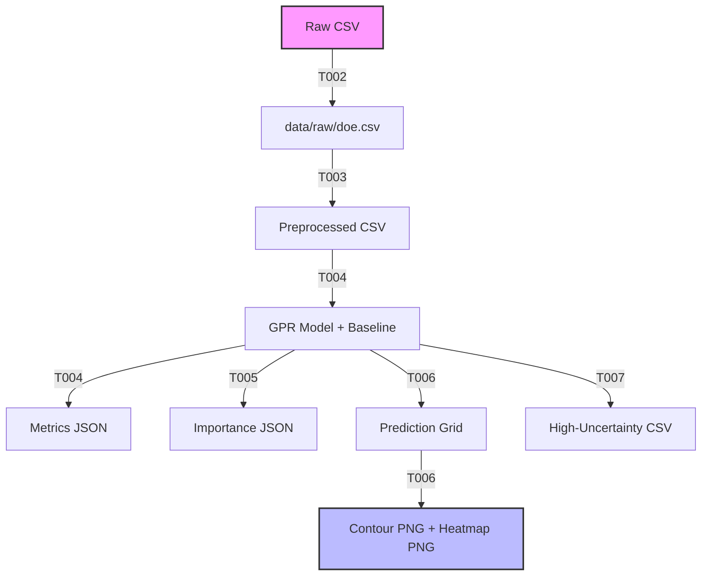

# Data Model: Unveiling Hidden Correlations Between Processing Parameters and Mechanical Properties in Additively Manufactured Alloys

## 1. Conceptual Model
The pipeline transforms **raw experimental records** into a **processed table** that feeds a **Gaussian Process Regression** model. The model produces predictions, uncertainties, and importance scores, all persisted as JSON artifacts.

## 2. Entities & Schemas

### 2.1 Raw Dataset Record (`data/raw/doe.csv`)
| Field | Type | Description |
|-------|------|-------------|
| `x1` | float | Numeric experimental factor 1 (proxy for a processing parameter). |
| `x2` | float | Numeric experimental factor 2. |
| `x3` | float | Numeric experimental factor 3. |
| `response` | float | Measured outcome (proxy for a mechanical property). |

### 2.2 Processed Record (`data/processed/preprocessed.csv`)
| Field | Type | Constraints |
|-------|------|-------------|
| `x1_norm` | float | Min‑max normalized to [0, 1]. |
| `x2_norm` | float | Min‑max normalized to [0, 1]. |
| `x3_norm` | float | Min‑max normalized to [0, 1]. |
| `response_norm` | float | Min‑max normalized to [0, 1]. |
| *(optional categorical flags)* | integer (0/1) | One‑hot encoded if any categorical columns exist (none for this dataset). |

### 2.3 Model Artifact (`results/model/gpr_model.joblib`)
- Serialized `GaussianProcessRegressor` (scikit‑learn) with trained hyperparameters.
- Includes training‑set feature scaling parameters for reproducible inference.

### 2.4 Metrics Output (`results/metrics.json`) – conforms to `contracts/model_output.schema.yaml`
- `r2_score` (float) – GPR test R².  
- `rmse` (float) – Root Mean Square Error.  
- `mae` (float) – Mean Absolute Error.  
- `rmse_percentage_range` (float) – RMSE expressed as % of observed target range.  
- `hyperparameters` (object) – `length_scale`, `sigma`.  
- `high_uncertainty_ratio` (float, 0‑1).  
- `feature_importance` (array of `{feature_name, importance_score}`).  
- `baseline_r2` (float).  
- `importance_correlation` (float).  
- `residual_analysis` (object).  
- `runtime_seconds` (float).  

### 2.5 Visualization Metadata (`results/visualization/<plot>.json`) – conforms to `contracts/visualization.schema.yaml`
Fields: `file_name`, `x_axis`, `y_axis`, `z_axis`, `uncertainty_flag`, `max_uncertainty`, `median_uncertainty`.

## 3. Logical Data Flow

## 4. Data Constraints
- **Non‑negative values** for all numeric fields after preprocessing.  
- **Normalization**: All numeric features must lie in `[0, 1]`.  
- **Completeness**: No missing values in `data/processed/preprocessed.csv`.  
- **Zero‑variance** columns are dropped with a logged warning.  
- **Sample Count**: Minimum 50 rows (enforced in T002).  

---
