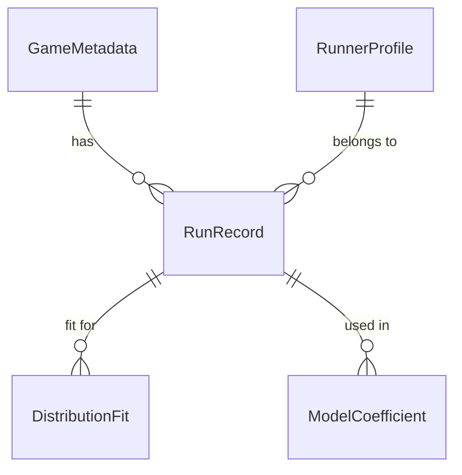

# Data Model: Statistical Analysis of Speedrun Data

## 1. Entity‑Relationship Overview
Four core entities: `RunRecord`, `RunnerProfile`, `GameMetadata`, `DistributionFit`. Relationships are one‑to‑many from `GameMetadata` → `RunRecord` and `RunnerProfile` → `RunRecord`.

## 2. Entity Definitions

### 2.1 `RunRecord`
| Attribute | Type | Description | Source |
|-----------|------|-------------|--------|
| `run_id` | string | Hash of `game_id` + `runner_id` + `attempt_number`. | Derived |
| `game_id` | string | Game identifier from speedrun.com. | API |
| `runner_id` | string | Runner identifier from speedrun.com. | API |
| `attempt_number` | integer | Sequential attempt number for this runner‑game pair. | API |
| `run_time_seconds` | number | Run time in seconds. | API |
| `category` | string | Category (e.g., “any%”). | API |
| `submission_date` | string (date) | Date of submission. | API |
| `total_prior_runs` | integer | Count of runs by this runner before this attempt (descriptive). | Derived |
| `time_since_first_run_days` | number | Days since runner’s first run in this game. | Derived |
| `difficulty_label` | string | null | External difficulty rating (optional). | External |
| `competitive_pressure` | number | Lagged count of active runners in the 30‑day window before `submission_date`. | Derived |
| `sample_flag` | string | “low-sample” if the game has < 100 runs, else “ok”. | Derived |

### 2.2 `RunnerProfile`
| Attribute | Type | Description |
|-----------|------|-------------|
| `runner_id` | string | Unique runner ID. |
| `total_runs` | integer | Total runs across all games. |
| `games_played_count` | integer | Number of distinct games played. |
| `first_run_date` | string (date) | Earliest run date. |
| `avg_run_time` | number | Mean run time (seconds). |

### 2.3 `GameMetadata`
| Attribute | Type | Description |
|-----------|------|-------------|
| `game_id` | string | Unique game identifier. |
| `game_name` | string | Human‑readable name. |
| `difficulty_label` | string | null | External difficulty rating. |
| `active_runners_count` | integer | Unique runners in the last 30 days. |
| `total_runs` | integer | Total runs for the game. |
| `sample_flag` | string | “low-sample” / “ok”. |

### 2.4 `DistributionFit`
| Attribute | Type | Description |
|-----------|------|-------------|
| `game_id` | string | Game identifier. |
| `distribution_family` | string (enum) | “log-normal”, “Weibull”, or “gamma”. |
| `parameters` | object | Fitted parameters (e.g., `{"mu":1.2,"sigma":0.5}`). |
| `KS_D` | number | Kolmogorov‑Smirnov statistic. |
| `KS_pvalue` | number | KS test p‑value. |
| `AIC` | number | Akaike Information Criterion. |
| `rejected` | boolean | True if Bonferroni‑adjusted p < 0.05. |

### 2.5 `ModelCoefficient`
| Attribute | Type | Description |
|-----------|------|-------------|
| `model_id` | string | Identifier for the mixed‑effects model run. |
| `predictor_name` | string | Name of predictor (e.g., “log_attempt”). |
| `coefficient` | number | Estimated coefficient. |
| `standard_error` | number | SE of the estimate. |
| `p_value` | number | Bonferroni‑corrected p‑value. |
| `random_effect_variance` | number | Variance of the `(1|RunnerID)` random effect. |

## 3. Data Flow
1. **Raw API dump** → `data/raw/speedrun_api.json` (T001).  
2. **Preprocessed table** → `data/processed/run_records.csv` (T002).  
3. **Derived tables** → `distribution_fits.csv`, `mixed_effects_results.csv` (T003, T004).  
4. **Checkpoints** → `data/checkpoints/game_<id>.pkl` (T015a/b).  

## 4. Constraints & Validation
- **Uniqueness**: `run_id` must be unique.  
- **Non‑null**: `run_time_seconds`, `runner_id`, `game_id`, `attempt_number` cannot be null.  
- **Ranges**: `run_time_seconds` > 0; `attempt_number` ≥ 1.  
- **Completeness**: After preprocessing, ≥ 95 % of original records must remain (SC‑003).  
- **Sample Size**: Games with < 100 runs flagged “low‑sample” and excluded from parametric fitting.  
- **Collinearity**: `total_prior_runs` excluded from fixed effects; VIF ≤ 5 required for all retained predictors (FR‑011).  

---
