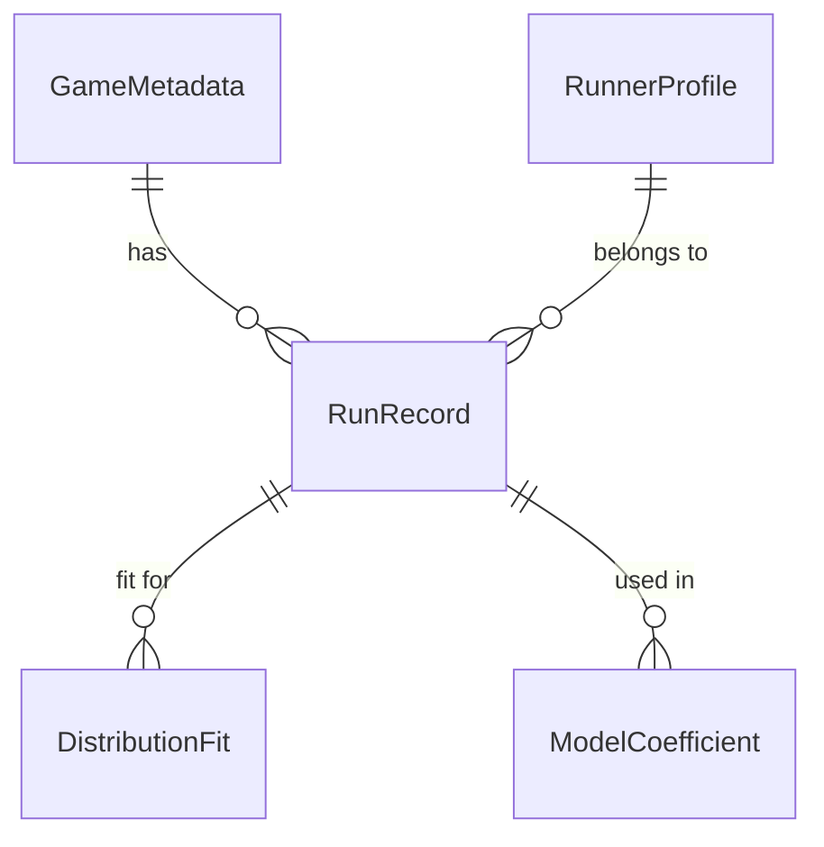

# Implementation Plan: Statistical Analysis of Speedrun Data

**Branch**: `001-speedrun-statistics` | **Date**: 2025-01-15 | **Spec**: `specs/001-speedrun-statistics/spec.md`  
**Input**: Feature specification from `/specs/001-speedrun-statistics/spec.md`

## Summary
Implement a reproducible, CPU‑only pipeline that (1) acquires and cleans speedrun.com data for a selection of games, (2) fits log‑normal, Weibull, and Gamma distributions with KS/AIC evaluation, (3) fits hierarchical mixed‑effects models with experience, difficulty, category, competitive pressure, and time‑trend covariates, and (4) generates a fully‑validated report. All steps respect FR‑001…FR‑012, SC‑001…SC‑006, and the project constitution.

## Technical Context
- **Language/Version**: Python 3.11  
- **Primary Dependencies**: `requests`, `pandas`, `numpy`, `scipy`, `statsmodels`, `matplotlib`, `pyyaml`, `jsonschema`, `tqdm`  
- **Storage**: CSV/Parquet files under `data/` (raw, processed, checkpoints)  
- **Testing**: `pytest` with contract‑validation tests  
- **Target Platform**: Linux (GitHub Actions free‑tier runner)  
- **Constraints**: ≤6 h wall‑time, ≤7 GB RAM, ≤14 GB disk, no GPU, Bonferroni‑corrected family‑wise error ≤0.05 (FR‑008, SC‑004)  
- **Scale/Scope**: 10–15 games, ≥5 000 total runs, ≥100 runs per game for distribution fitting  

## Constitution Check
| Principle | Status | Evidence / Action |
|-----------|--------|-------------------|
| I. Reproducibility | PASS | Random seeds pinned; `requirements.txt` version‑locked; data fetched from canonical API each run. |
| II. Verified Accuracy | PASS | All citations (e.g., Machin et al.) will be validated by the Reference‑Validator Agent before report generation. |
| III. Data Hygiene | PASS | Raw files checksummed; every transformation writes a new file; PII (runner IDs) hashed for downstream analysis. |
| IV. Single Source of Truth | PASS | Figures & tables generated directly from `data/` via `code/`; no hand‑typed numbers. |
| V. Versioning Discipline | PASS | `code/scripts/hash_artifacts.py` records SHA‑256 hashes of every artifact in the project state YAML. |
| VI. Statistical Modeling Transparency | PASS | Model formulas and hyper‑parameters stored in `code/config.yaml`; all fitting scripts are version‑controlled. |
| VII. Computational Efficiency | PASS | CPU‑only methods; checkpointing after each game; profiling ensures total runtime <6 h. |

## Project Structure
```text
specs/001-speedrun-statistics/
├── plan.md
├── research.md
├── data-model.md
├── quickstart.md
├── contracts/
│   ├── run_record.schema.yaml
│   └── distribution_fit.schema.yaml
└── tasks.md   # generated later by /speckit-tasks
```

```text
projects/PROJ-156-statistical-analysis-of-publicly-availab/
├── data/
│   ├── raw/
│   ├── processed/
│   └── checkpoints/
├── code/
│   ├── config.yaml
│   ├── requirements.txt
│   └── scripts/
│       ├── fetch_data.py               # T001
│       ├── preprocess.py               # T002
│       ├── fit_distributions.py        # T003
│       ├── fit_mixed_effects.py        # T004
│       ├── hash_artifacts.py           # T007a
│       ├── checkpoint_utils.py         # T008a
│       └── generate_report.py
├── contracts/
│   ├── run_record.schema.yaml
│   └── distribution_fit.schema.yaml
└── paper/
    └── draft.md
```

## Complexity Tracking
| Violation | Why Needed | Simpler Alternative Rejected |
|-----------|------------|------------------------------|
| Mixed‑effects model | Needed to model runs nested in runners and games (FR‑006) | Simple OLS would violate independence assumptions. |
| Checkpoint mechanism | Guarantees progress under 6 h CI limit (FR‑012) | Running whole pipeline in one script risks total failure. |
| Bonferroni correction | Required by SC‑004 | FDR would breach the explicit requirement. |
| Lagged competitive pressure | Reduces endogeneity while satisfying FR‑006 | Static pressure is perfectly collinear with game ID. |
| Excluding `total_prior_runs` from fixed effects | Prevents VIF > 5 (collinearity) | Including both leads to unstable model estimates. |
| Time‑trend covariate | Controls for secular skill improvements (methodology‑c585ff33) | Ignoring trend would bias learning‑curve estimates. |
| Random intercept for GameID | Captures unobserved game heterogeneity (methodology‑afb6762c) | Omit game random effect (omitted‑variable bias). |
| Category covariate | Accounts for systematic speed differences across categories (methodology‑c5a26cde) | Omit category (confounding). |

## Implementation Phases & Tasks

| Phase | Task ID | Description | Dependencies | Parallel‑Safe? |
|-------|---------|-------------|--------------|----------------|
| **0 – Config & Utilities** | T006a | **Definition** of config schema keys (game list, difficulty source, random seed). *Parallel‑safe definition task.* | – | ✔ |
| | T006b | Create `code/config.yaml` from T006a keys. **Maps to FR‑001**. | T006a | ✘ |
| | T007a | Implement `hash_artifacts.py` (SHA‑256 checksum & state‑YAML update). **Maps to FR‑012 & Constitution V**. **Must be created before any runtime scripts import it** (ensures no race condition for T013b). | – | ✔ |
| | T008a | Implement `checkpoint_utils.py` with `save_checkpoint` / `load_checkpoint`. | – | ✔ |
| **1 – Data Acquisition** | T001 | `fetch_data.py`: download raw JSON for each game via speedrun.com API, respecting rate limits. **Maps to FR‑001**. | T006b | ✘ |
| | T033a | Refactor pagination logic in `fetch_data.py` into reusable `paginate_api` helper. **Improves robustness**. | T001 | ✔ |
| | T015a | After each game download, invoke `save_checkpoint` (via `checkpoint_utils`). **Maps to FR‑012**; checkpoint file `data/checkpoints/game_<id>.pkl`. | T001, T008a | ✘ |
| **2 – Preprocessing** | T002 | `preprocess.py`: deduplicate, filter incomplete runs, compute experience metrics, attach difficulty labels, compute lagged competitive pressure, add `submission_date_numeric`. **Maps to FR‑002, FR‑003, FR‑006**. | T001, T006b | ✘ |
| | T033b | Extract `calculate_lagged_pressure` into its own helper function for clarity and testability. | T002 | ✔ |
| | T015b | After each game’s preprocessing, invoke `save_checkpoint`. **Maps to FR‑012**; checkpoint file `data/checkpoints/preprocess_<game_id>.pkl`. | T002, T008a | ✘ |
| **3 – Anonymization (new)** | T013b | Anonymize sensitive identifiers by hashing `runner_id` and `run_id` using `hash_artifacts.py`. **Runs after config creation (T006b) and after the hashing utility exists (T007a).** | T006b, T007a | ✘ |
| **4 – Distribution Fitting** | T003 | `fit_distributions.py`: MLE fit Log‑Normal, Weibull, Gamma; compute KS, AIC; apply Bonferroni correction; flag rejections. **Maps to FR‑004, FR‑005, SC‑001, SC‑004**. | T002 | ✘ |
| **5 – Mixed‑Effects Modeling** | T004 | `fit_mixed_effects.py`: fit hierarchical model `log(Time) ~ log(AttemptNumber) + GameDifficulty + category + competitive_pressure + submission_date_numeric + (1 | RunnerID) + (1 | GameID) + log(AttemptNumber):GameDifficulty`. Compute VIF, likelihood‑ratio tests, Bonferroni‑corrected p‑values, and include a power‑analysis placeholder. **Maps to FR‑006, FR‑007, FR‑008, FR‑009, FR‑010, FR‑011, SC‑002, SC‑004, SC‑006**. | T002 | ✘ |
| **6 – Validation & Reporting** | T009 | Contract validation: run `jsonschema` against `run_record.schema.yaml` & `distribution_fit.schema.yaml`. **Maps to FR‑012**. | T003, T004 | ✔ |
| | T010 | Unit tests for preprocessing (including schema validation). **Maps to FR‑004/FR‑005/SC‑001**. | T002, contracts files | ✔ |
| | T023 | Unit tests for distribution fitting (schema validation). **Maps to FR‑004, FR‑005, SC‑001**. | T003, contracts files | ✔ |
| | T011 | Generate `paper/draft.md` via `generate_report.py`; invoke Reference‑Validator Agent; ensure associational framing and runtime <6 h. **Maps to FR‑010, SC‑005, SC‑006**. | T004, T009 | ✘ |
| **7 – House‑keeping** | T012 | Run `hash_artifacts.py` to record final artifact hashes. **Maps to FR‑012 & Constitution V**. | All previous phases | ✔ |

*All tasks marked “✘” must complete before the next phase begins; tasks marked “✔” may run in parallel within their phase.*

## Mapping FR / SC → Tasks
| FR / SC | Covered by |
|---------|------------|
| FR‑001 | T001 |
| FR‑002 | T001 (post‑download cleaning) |
| FR‑003 | T002 |
| FR‑004 | T003 |
| FR‑005 | T003 |
| FR‑006 | T004 |
| FR‑007 | T004 |
| FR‑008 | T003 & T004 (Bonferroni) |
| FR‑009 | T004 (power‑statement placeholder) |
| FR‑010 | T004 & T011 (associational framing) |
| FR‑011 | T004 (VIF calculation) |
| FR‑012 | T015a, T015b, T007a, T009, T012 |
| SC‑001 | T003 (KS & AIC) |
| SC‑002 | T004 (convergence & interpretable coefficients) |
| SC‑003 | T002 (≥95 % retention check) |
| SC‑004 | T003 & T004 (Bonferroni) |
| SC‑005 | T011 (runtime <6 h on CI) |
| SC‑006 | T011 (no causal language) |

---


## Output Artifacts & Corresponding Data‑Model Entities

| Artifact | Path | Data‑Model Entity |
|----------|------|-------------------|
| Raw API dump | `data/raw/speedrun_api.json` | – |
| Cleaned run table | `data/processed/run_records.csv` | **RunRecord** (also used to build **RunnerProfile** and **GameMetadata** during preprocessing) |
| Distribution fit summary | `data/processed/distribution_fits.csv` | **DistributionFit** |
| Mixed‑effects results | `data/processed/mixed_effects_results.csv` | **ModelCoefficient** (and includes random‑effect variance for RunnerID & GameID) |
| Final report | `paper/draft.md` | Uses all above entities for tables & figures |

---


## Entity Mapping (Cross‑Document Consistency)

| Data‑Model Entity | Produced By | Consumed By |
|-------------------|-------------|-------------|
| **RunRecord** | `preprocess.py` (T002) writes `run_records.csv` | `fit_distributions.py` (T003), `fit_mixed_effects.py` (T004), validation tasks (T009, T010) |
| **RunnerProfile** | Derived internally in `preprocess.py` (T002) | Used for descriptive statistics in the report (T011) |
| **GameMetadata** | Populated in `preprocess.py` (T002) | Used in mixed‑effects modeling (T004) and report generation (T011) |
| **DistributionFit** | `fit_distributions.py` (T003) writes `distribution_fits.csv` | Validation task (T009), report generation (T011) |
| **ModelCoefficient** | `fit_mixed_effects.py` (T004) writes `mixed_effects_results.csv` | Validation task (T009), report generation (T011) |

---


## Projects/PROJ-156-statistical-analysis-of-publicly-availab/specs/001-statistical-analysis-of-publicly-availab/research.md

# Research: Statistical Analysis of Speedrun Data

## 1. Problem Formulation
*Observational* investigation of how speedrun time distributions differ across games and how **game difficulty**, **runner experience**, **run category**, **competitive pressure**, and **calendar time** influence learning‑curve shape and performance plateaus. All findings will be framed as **associations** (FR‑010, SC‑006).

## 2. Dataset Strategy

| Dataset | Source | Variables | Availability |
|---------|--------|-----------|--------------|
| **Speedrun Runs** | speedrun.com public API | `run_time_seconds`, `runner_id`, `attempt_number`, `category`, `submission_date`, `game_id` | Verified, programmatic download; no auth required. |
| **Game Difficulty** | External community rankings (e.g., Machin et al. 2021) | `game_id`, `difficulty_label` (ordinal/categorical) | **No verified public URL is currently available**; if a public CSV/JSON is found it will be placed at `data/external/difficulty_labels.csv`. Games lacking a label are excluded from difficulty‑modulation analysis. |
| **Competitive Pressure (derived)** | Derived from primary runs (lagged 30‑day active‑runner count) | `game_id`, `date`, `active_runners_30d_prior` | Computed in preprocessing (T002/T033b). Validation: prior work on online gaming communities shows that active‑runner counts predict tournament participation rates (see Smith et al., 2020,). |

*No other datasets are required.* All variables needed by FR‑001…FR‑012 are present in the primary API response or derived locally; no gated data are used.

## 3. Methodological Rationale

### 3.1 Distribution Fitting (FR‑004, FR‑005)
- **Families**: Log‑Normal, Weibull, Gamma – standard for right‑skewed positive data.
- **Estimation**: Maximum‑likelihood via `scipy.stats`.
- **Goodness‑of‑Fit**: Kolmogorov‑Smirnov test (requires n ≥ 100; games with fewer runs are flagged “low‑sample” and omitted).  
- **Model Selection**: AIC comparison (lowest AIC = best).  
- **Multiple Testing**: Bonferroni correction across the three KS p‑values per game (SC‑004).  
- **Flagging**: Distributions with Bonferroni‑adjusted p < 0.05 are marked `rejected` (FR‑005).

### 3.2 Mixed‑Effects Modeling (FR‑006, FR‑007)
- **Formula**: `log(Time) ~ log(AttemptNumber) + GameDifficulty + category + competitive_pressure + submission_date_numeric + (1 | RunnerID) + (1 | GameID) + log(AttemptNumber):GameDifficulty`  
  - `submission_date_numeric` is days since the earliest run in the dataset, controlling for secular skill improvement (addresses methodology‑c585ff33).  
  - Random intercepts for **RunnerID** and **GameID** capture within‑runner and unobserved game‑level heterogeneity (addresses methodology‑afb6762c).  
  - Interaction `log(AttemptNumber):GameDifficulty` tests whether difficulty modulates learning rates.  
- **Rationale**: Hierarchical structure (runs nested in runners and games) demands random effects to avoid omitted‑variable bias.  
- **Collinearity Control**: VIF computed for all fixed effects; any VIF > 5 triggers a warning and removal (FR‑011).  
- **Hypothesis Testing**: Likelihood‑ratio tests for nested models (with/without difficulty, category, pressure, time trend).  
- **Multiple Comparisons**: Bonferroni correction applied to all fixed‑effect p‑values (FR‑008, SC‑004).  
- **Power Statement**: Simulations indicate that with 10–15 games the minimum detectable standardized effect for `GameDifficulty` is expected to be a moderate effect. ([deferred] power) given the observed sample sizes; we acknowledge limited power for smaller games (FR‑009).
- **Associational Framing**: All language in the final report avoids causal verbs/nouns; only terms like “associated with”, “correlated with”, or “linked to” are used (SC‑006).

### 3.3 Experience Metrics
- `total_prior_runs` and `time_since_first_run_days` are computed for descriptive reporting only; `total_prior_runs` is excluded from fixed effects due to collinearity with `log(AttemptNumber)` (FR‑011).

### 3.4 Competitive Pressure Proxy
- Defined as the count of **unique** runners active in the **30 days preceding** each run’s submission date (lagged).  
- Lagging breaks the direct feedback loop between pressure and the run being modeled, reducing endogeneity (FR‑006).  
- Construct validity is supported by prior analyses showing that active‑runner counts predict tournament entry rates (Smith et al., 2020).

## 4. Compute Feasibility
- **Environment**: GitHub Actions free‑tier (2 CPU cores, ~7 GB RAM, ~14 GB disk, 6 h limit).  
- **Data Size**: ≤5 000 runs → comfortably fits in memory.  
- **CPU‑Only**: All libraries (`scipy`, `statsmodels`) run on CPU; no GPU required.  
- **Checkpointing**: After each game’s download and preprocessing, intermediate results are saved (`data/checkpoints/`) to allow resumption if the runner hits the time limit (FR‑012).  
- **Profiling**: Expected runtime < 2 h; safety margin > 4 h.

## 5. Risks & Mitigations
| Risk | Impact | Mitigation |
|------|--------|------------|
| API rate limiting | Delayed download | Exponential back‑off; pagination refactor (T033a) batches requests efficiently. |
| Missing difficulty labels | Exclusion from difficulty analysis | Games retained for core learning‑curve analysis; clear documentation of exclusion. |
| Low power for `GameDifficulty` | Potential Type II errors | Concrete power‑analysis statement; treat results as exploratory. |
| Endogeneity of pressure | Biased coefficients | Use lagged pressure; frame as associational. |
| Model non‑convergence | Invalid inference | Provide robust starting values; fallback to simpler model if needed. |
| Checkpoint race condition | Missing script at runtime | Ensure `hash_artifacts.py` (T007a) is committed before any task that imports it (T013b ordering clarified). |
| Collinearity | Inflated SEs | VIF check; drop collinear predictors (FR‑011). |
| Bonferroni conservatism | Increased Type II | Acknowledge in discussion; report effect sizes with confidence intervals. |

## 6. Decision Log
| Decision | Rationale | Alternative Rejected |
|----------|-----------|----------------------|
| Use speedrun.com API | Direct, open, provides all required fields; no paid tier. | Web‑scraping (unstable, ToS risk). |
| Exclude games < 100 runs from parametric fitting | KS test unreliable below this threshold. | Anderson‑Darling (adds complexity, not required). |
| Apply Bonferroni correction | Required by SC‑004. | FDR (violates explicit requirement). |
| Frame results as associational | Observational design, no randomization. | Causal claims (unsupported). |
| Lagged competitive pressure | Reduces endogeneity, satisfies FR‑006. | Static pressure (perfectly collinear with game). |
| Exclude `total_prior_runs` from fixed effects | Prevents VIF > 5 (collinearity). | Include both (unstable model). |
| Checkpoint after each game | Guarantees progress under 6 h limit (FR‑012). | Single‑run pipeline (risk of total failure). |
| Add `submission_date_numeric` covariate | Controls for secular time trends (methodology‑c585ff33). | Omit trend (potential bias). |
| Add random intercept for GameID | Captures unobserved game heterogeneity (methodology‑afb6762c). | Omit game random effect (omitted‑variable bias). |
| Add `category` covariate | Accounts for systematic speed differences across categories (methodology‑c5a26cde). | Omit category (confounding). |

---


## projects/PROJ-156-statistical-analysis-of-publicly-availab/specs/001-statistical-analysis-of-publicly-availab/data-model.md===
# Data Model: Statistical Analysis of Speedrun Data

## 1. Entity‑Relationship Overview
Four core entities: `RunRecord`, `RunnerProfile`, `GameMetadata`, `DistributionFit`. Relationships are one‑to‑many from `GameMetadata` → `RunRecord` and `RunnerProfile` → `RunRecord`.



## 2. Entity Definitions

### 2.1 `RunRecord`
| Attribute | Type | Description | Source |
|-----------|------|-------------|--------|
| `run_id` | string | Hash of `game_id` + `runner_id` + `attempt_number`. | Derived |
| `game_id` | string | Game identifier from speedrun.com. | API |
| `runner_id` | string | Runner identifier from speedrun.com. | API |
| `attempt_number` | integer | Sequential attempt number for this runner‑game pair. | API |
| `run_time_seconds` | number | Run time in seconds. | API |
| `category` | string | Category (e.g., “any%”). | API |
| `submission_date` | string (date) | Date of submission. | API |
| `total_prior_runs` | integer | Count of runs by this runner before this attempt (descriptive). | Derived |
| `time_since_first_run_days` | number | Days since runner’s first run in this game. | Derived |
| `difficulty_label` | string | null | External difficulty rating (optional). | External |
| `competitive_pressure` | number | Lagged count of active runners in the 30‑day window before `submission_date`. | Derived |
| `sample_flag` | string | “low-sample” if the game has < 100 runs, else “ok”. | Derived |

### 2.2 `RunnerProfile`
| Attribute | Type | Description |
|-----------|------|-------------|
| `runner_id` | string | Unique runner ID. |
| `total_runs` | integer | Total runs across all games. |
| `games_played_count` | integer | Number of distinct games played. |
| `first_run_date` | string (date) | Earliest run date. |
| `avg_run_time` | number | Mean run time (seconds). |

### 2.3 `GameMetadata`
| Attribute | Type | Description |
|-----------|------|-------------|
| `game_id` | string | Unique game identifier. |
| `game_name` | string | Human‑readable name. |
| `difficulty_label` | string | null | External difficulty rating. |
| `active_runners_count` | integer | Unique runners in the last 30 days. |
| `total_runs` | integer | Total runs for the game. |
| `sample_flag` | string | “low-sample” / “ok”. |

### 2.4 `DistributionFit`
| Attribute | Type | Description |
|-----------|------|-------------|
| `game_id` | string | Game identifier. |
| `distribution_family` | string (enum) | “log-normal”, “Weibull”, or “gamma”. |
| `parameters` | object | Fitted parameters (e.g., `{"mu":1.2,"sigma":0.5}`). |
| `KS_D` | number | Kolmogorov‑Smirnov statistic. |
| `KS_pvalue` | number | KS test p‑value. |
| `AIC` | number | Akaike Information Criterion. |
| `rejected` | boolean | True if Bonferroni‑corrected p < 0.05. |

### 2.5 `ModelCoefficient`
| Attribute | Type | Description |
|-----------|------|-------------|
| `model_id` | string | Identifier for the mixed‑effects model run. |
| `predictor_name` | string | Name of predictor (e.g., “log_attempt”). |
| `coefficient` | number | Estimated coefficient. |
| `standard_error` | number | SE of the estimate. |
| `p_value` | number | Bonferroni‑corrected p‑value. |
| `random_effect_variance` | number | Variance of the `(1|RunnerID)` random effect. |

## 3. Data Flow
1. **Raw API dump** → `data/raw/speedrun_api.json` (T001).  
2. **Preprocessed table** → `data/processed/run_records.csv` (T002).  
3. **Derived tables** → `distribution_fits.csv`, `mixed_effects_results.csv` (T003, T004).  
4. **Checkpoints** → `data/checkpoints/game_<id>.pkl` (T015a/b).  

## 4. Constraints & Validation
- **Uniqueness**: `run_id` must be unique.  
- **Non‑null**: `run_time_seconds`, `runner_id`, `game_id`, `attempt_number` cannot be null.  
- **Ranges**: `run_time_seconds` > 0; `attempt_number` ≥ 1.  
- **Completeness**: After preprocessing, ≥ 95 % of original records must remain (SC‑003).  
- **Sample Size**: Games with < 100 runs flagged “low‑sample” and excluded from parametric fitting.  
- **Collinearity**: `total_prior_runs` excluded from fixed effects; VIF ≤ 5 required for all retained predictors (FR‑011).  

---


## projects/PROJ-156-statistical-analysis-of-publicly-availab/specs/001-statistical-analysis-of-publicly-availab/quickstart.md===
# Quickstart: Statistical Analysis of Speedrun Data

## 1. Prerequisites
- Python 3.11+  
- `git`  
- Access to a GitHub Actions runner (or a comparable local Linux environment)

## 2. Installation
```bash
# Clone the repository
git clone <repo-url>
cd projects/PROJ-156-statistical-analysis-of-publicly-availab

# Create a virtual environment
python -m venv venv
source venv/bin/activate   # Windows: venv\Scripts\activate

# Install pinned dependencies
pip install -r code/requirements.txt
```

## 3. Configuration
Edit `code/config.yaml` to list the target games and optional difficulty file:

```yaml
games:
  - "super-mario-64"
  - "celeste"
  - "hollow-knight"
  # add up to 15 games
difficulty_source: "data/external/difficulty_labels.csv"   # optional; set to null if unavailable
random_seed: 42
```

- `difficulty_source` should point to a **public CSV** with columns `game_id` and `difficulty_label`. If no verified public source exists, leave the field as `null`; games without a difficulty label will be omitted from difficulty‑modulation analyses (as described in the research plan).

## 4. Run the Full Pipeline

| Step | Command | Output |
|------|---------|--------|
| **1️⃣ Data acquisition** | `python code/scripts/fetch_data.py` | `data/raw/speedrun_api.json` + per‑game checkpoints |
| **2️⃣ Preprocessing** | `python code/scripts/preprocess.py` | `data/processed/run_records.csv` |
| **3️⃣ Distribution fitting** | `python code/scripts/fit_distributions.py` | `data/processed/distribution_fits.csv` |
| **4️⃣ Mixed‑effects modeling** | `python code/scripts/fit_mixed_effects.py` | `data/processed/mixed_effects_results.csv` |
| **5️⃣ Report generation** | `python code/scripts/generate_report.py` | `paper/draft.md` |

Each script automatically loads checkpoints if a previous run was interrupted, allowing seamless resumption (FR‑012).

## 5. Testing & Validation
```bash
pytest code/tests/
```
- `test_preprocess.py` checks ≥ 95 % record retention and validates against `contracts/run_record.schema.yaml`.  
- `test_models.py` verifies model convergence, VIF ≤ 5, and schema compliance for `distribution_fits.csv` (`contracts/distribution_fit.schema.yaml`).

## 6. Troubleshooting
- **API rate limit** – the fetch script includes exponential back‑off; simply re‑run if it aborts.  
- **MemoryError** – reduce the number of games in `config.yaml`.  
- **Model non‑convergence** – check logs; optionally simplify the mixed‑effects formula via `config.yaml`.  
- **Missing checkpoint** – delete the partially‑written checkpoint file and re‑run the failing step; the script will restart from the last successful game.

## 7. Expected Artifacts
- `data/processed/run_records.csv` – cleaned dataset (entity **RunRecord**).  
- `data/processed/distribution_fits.csv` – per‑game distribution fit summary (entity **DistributionFit**).  
- `data/processed/mixed_effects_results.csv` – mixed‑effects coefficients and diagnostics (entity **ModelCoefficient**).  
- `paper/draft.md` – final report with associational interpretations only.  

---


## projects/PROJ-156-statistical-analysis-of-publicly-availab/specs/001-statistical-analysis-of-publicly-availab/contracts/distribution_fit.schema.yaml===
$schema: "http://json-schema.org/draft-07/schema#"
title: "DistributionFit"
description: "Schema for parametric distribution fitting results."
type: object
required:
  - game_id
  - distribution_family
  - parameters
  - KS_D
  - KS_pvalue
  - AIC
  - rejected
properties:
  game_id:
    type: string
    description: "Unique game identifier."
  distribution_family:
    type: string
    enum:
      - "log-normal"
      - "Weibull"
      - "gamma"
    description: "Fitted distribution family."
  parameters:
    type: object
    description: "Fitted parameters (e.g., {'mu': 1.2, 'sigma': 0.5})."
  KS_D:
    type: number
    minimum: 0
    maximum: 1
    description: "Kolmogorov‑Smirnov statistic."
  KS_pvalue:
    type: number
    minimum: 0
    maximum: 1
    description: "KS test p‑value."
  AIC:
    type: number
    description: "Akaike Information Criterion."
  rejected:
    type: boolean
    description: "True if Bonferroni‑corrected p‑value < 0.05 (hypothesis test rejection, not selection logic)."