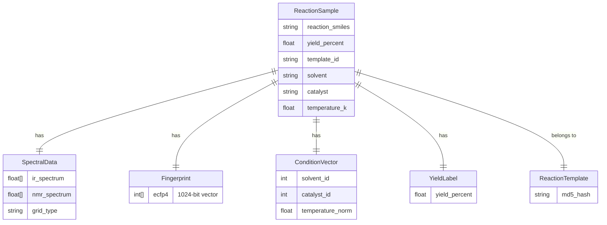

# Data Model: Predicting Chemical Reaction Yields from Spectroscopic Data with Attention Mechanisms

## 1. Conceptual Entity‑Relationship Diagram

## 2. Core Entities

| Entity | Attributes | Type / Constraints |
|--------|------------|--------------------|
| **ReactionSample** | `reaction_smiles`, `yield_percent`, `template_id`, `solvent`, `catalyst`, `temperature_k` | Primary analysis unit |
| **SpectralData** | `ir_spectrum` (array of 1000 floats, grid 400‑4000 cm⁻¹, step = 1 cm⁻¹), `nmr_spectrum` (array of 1000 floats, grid 0‑10 ppm, step = 0.01 ppm) | Resampled, unit‑variance normalized |
| **Fingerprint** | `ecfp4` (1024‑bit integer array) | Generated via RDKit |
| **ConditionVector** | `solvent_id` (one‑hot/int), `catalyst_id` (one‑hot/int), `temperature_norm` (float) | Encodes reaction environment |
| **YieldLabel** | `yield_percent` (float) | Target variable |
| **ReactionTemplate** | `md5_hash` (string) | Derived from Bemis‑Murcko scaffold; used for leakage checks |

## 3. Variable Reactant Handling (Methodology‑f96f913d)
Reactions can contain 1–3 reactants plus a product. To create a fixed‑size tensor for the attention model we:

1. **Pad** missing reactant spectra with zero‑filled arrays (same length as a real spectrum).  
2. **Order** the channels as Reactant 1, Reactant 2, Reactant 3, Product.  
3. **Concatenate** IR and NMR within each channel, yielding a per‑channel vector of length 2000 (1000 IR + 1000 NMR).  
4. The final input tensor shape is `[4 × 2000]`.  

This deterministic padding ensures all samples are compatible with the 4‑head self‑attention encoder.

## 4. Data‑Model ↔ Schema Alignment
- The schema `dataset.schema.yaml` defines the spectral fields with 1000 points each and uses the field name `fingerprint`.  
- For compatibility with downstream code that may reference the fingerprint as `rfp`, the schema also includes an alias property `rfp` with identical constraints.  
- All downstream pipelines accept either `fingerprint` or `rfp`; the plan and documentation primarily use `fingerprint` for clarity.

## 5. Data Flow
1. **Ingestion** (`src/data/ingestion.py`) – download USPTO reactions, query NIST & PubChem for JCAMP‑DX spectra, store raw files under `data/raw/`.  
2. **Preprocessing** (`src/data/preprocessing.py`) – resample, normalize, pad, compute fingerprints, encode conditions, generate MD5 template hashes, perform scaffold‑based split, write `train.parquet`, `val.parquet`, `test.parquet` under `data/processed/`.  
3. **Loading** (`src/data/loaders.py`) – PyTorch `Dataset` objects stream parquet rows into tensors matching the fixed‑size schema.  
4. **Model Training** – consumes tensors from loaders, produces `model.pth` and `training_log.csv`.  
5. **Evaluation & Interpretability** – generates `metrics.csv`, `wilcoxon_results.json`, `permutation_report.json`, heatmap PNGs, and `peak_alignment_report.json`.  

All generated files receive SHA‑256 checksums recorded in `state/projects/PROJ-165-.../artifact_hashes.yaml`.  

## 6. Constraints & Validation (Schema‑driven)

- **Yield Range**: `0.0 ≤ yield_percent ≤ 100.0`.  
- **Spectrum Length**: 1000 points per IR and NMR spectrum (as enforced by the schema).  
- **Template Uniqueness**: `template_id` appears in only one split (validated by `leakage_report.json`).  
- **Condition Balance**: Splits are stratified by solvent/catalyst categories (checked in `split_manifest.json`).  
- **Checksum Integrity**: Every file’s SHA‑256 must match entry in `state/...yaml`.  
- **VIF Threshold**: VIF ≤ 5 for all predictor groups; otherwise flagged in `evaluation_report.json`.  
- **Statistical Significance**: Bonferroni‑adjusted p < 0.0167 for required Wilcoxon tests (SC‑002).

All constraints are enforced by `src/utils/validators.py` before downstream steps.

---

