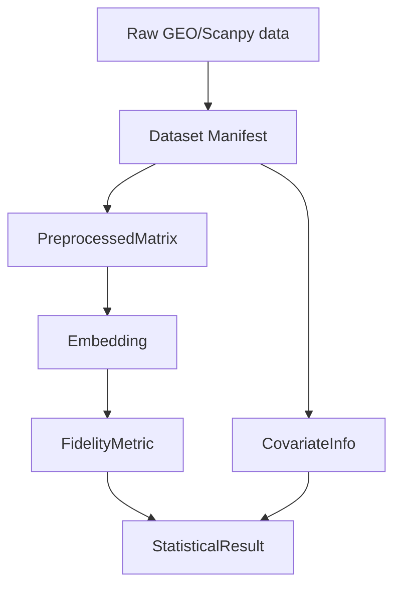

# Data Model: Statistical Evaluation of Dimensionality Reduction Techniques on Gene Expression Data

## Overview
All artifacts are stored under `data/` with strict versioning and checksum tracking. The model defines six core entity types that flow from raw ingestion to the final statistical report.

## Entities

| Entity | Fields | Description |
|--------|--------|-------------|
| **Dataset** | `dataset_id` (str), `source_url` (str), `status` (enum), `checksum` (str), `raw_path` (str), `processed_path` (str, nullable) | Represents a scRNA‑seq accession; `status` indicates availability. |
| **PreprocessedMatrix** | `dataset_id`, `matrix_path` (Parquet), `n_cells`, `n_genes`, `hvg_count`, `geometric_descriptors` (object) | Log‑CPM transformed, HVG‑selected, possibly sampled matrix. |
| **Embedding** | `dataset_id`, `method` (enum: PCA, tSNE, UMAP), `embedding_path` (CSV), `dimensions` (int), `hyperparameters` (object), `clustering` (object) | Low‑dimensional representation plus clustering info. |
| **FidelityMetric** | `dataset_id`, `method`, `metric_type` (enum: ARI, NMI), `value` (float 0–1), `silhouette_threshold` (float), `logit_value` (float) | ARI/NMI for a given embedding; `logit_value` used in modeling. |
| **MixedEffectsModel** | `model_type` (enum), `formula` (str), `fixed_effects` (array), `random_effects` (object), `vif_values` (object), `collinearity_passed` (bool), `permutation_p_value` (float, nullable) | Captures the fitted mixed‑effects regression output (retained for documentation). |
| **StatisticalResult** | `model_summary` (object), `sensitivity_analysis` (object), `execution_metadata` (object) | Final output aggregating model coefficients, sensitivity variance, and runtime/memory stats. |
| **CovariateInfo** | `cell_count` (int), `gene_count` (int), `batch` (string) | Additional confounding variables included in the statistical analysis (addresses methodology‑3b21f43d). |

## Data Flow Diagram

## Storage Formats
- **Raw data**: `data/raw/<dataset_id>.json` or `.csv` (as downloaded).  
- **Processed matrix**: Parquet (`data/processed/<dataset_id>_logcpm.parquet`).  
- **Geometric descriptors**: JSON (`data/processed/<dataset_id>_geometric.json`).  
- **Embeddings**: CSV (`data/embeddings/<dataset_id>_<method>.csv`).  
- **Fidelity metrics**: JSON (`data/metrics/fidelity_<dataset_id>.json`).  
- **Statistical result**: YAML (`data/results/statistical_result.yaml`).  
- **Manifest & checksums**: `data/manifest.json` (generated after Phase 0).  

## Contracts
All output files are validated against schemas in `contracts/` (e.g., `statistical_result.schema.yaml`). The manifest records a SHA‑256 checksum for every raw file, enabling reproducibility checks (Constitution III).

---

