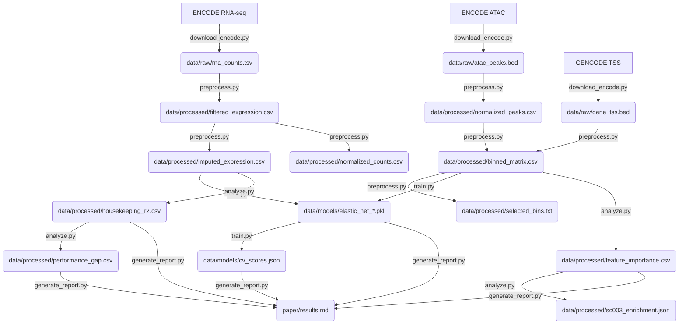

# Data Model: Predicting Gene Expression from Chromatin Accessibility

## 1. Overview
Defines every file‑level schema used throughout the pipeline, from raw ENCODE downloads to final model artifacts. All files are validated against JSON‑Schema contracts in `contracts/`.

## 2. Input Data Models

| File (under `data/raw/`) | Format | Key Columns | Description |
|--------------------------|--------|-------------|-------------|
| `rna_counts.tsv` | TSV | `gene_id`, `gene_name`, `sample_id`, `cell_line`, `count` | Raw RNA‑seq read counts from ENCODE (one row per gene‑sample). |
| `atac_peaks.bed` | BED | `chrom`, `start`, `end`, `score`, `strand` | ATAC‑seq narrowPeak calls (signal intensity in `score`). |
| `gene_tss.bed` | BED | `chrom`, `start`, `end`, `gene_id`, `gene_name` | GENCODE v44 TSS coordinates (hg38). |

All three files are accompanied by SHA‑256 checksums recorded in `state/projects/PROJ-211-predicting-gene-expression-from-chromati.yaml`.

## 3. Processed Data Models

| Artifact (under `data/processed/`) | Format | Columns / Structure | Constraints |
|-----------------------------------|--------|---------------------|-------------|
| `filtered_expression.csv` | CSV | `gene_id`, `cell_line`, `count` | Genes with zero count in **all** samples removed (FR‑003). |
| `imputed_expression.csv` | CSV | `gene_id`, `cell_line`, `log_count` | `log_count = log(count + 1)` (FR‑004); missing values imputed with median per gene (FR‑005). |
| `normalized_counts.csv` | CSV | `gene_id`, `cell_line`, `cpm` | CPM‑normalised RNA‑seq counts (library‑size scaling). |
| `normalized_peaks.csv` | CSV | `peak_id`, `cell_line`, `cpm` | CPM‑normalised ATAC/DNase scores. |
| `selected_bins.txt` | TXT (one integer per line) | Indices of bins retained after variance filter (≤ N‑1 per cell line). |
| `binned_matrix.csv` | CSV (wide) | `gene_id`, `cell_line`, `bin_1` … `bin_200` | Accessibility summed per 200 fixed‑width bins within ±50 kb of TSS; promoter region (±2 kb) forced to 0 (FR‑002, FR‑008). |
| `housekeeping_genes.csv` | CSV | `gene_id`, `gene_name`, `cv` | Genes with coefficient of variation < 0.2 across cell lines (derived for FR‑009). |
| `cell_type_specific_genes.csv` | CSV | `gene_id`, `gene_name`, `max_cv`, `cell_line` | Genes with CV > 0.5 in at least one line (derived for FR‑010). |
| `housekeeping_matrix.csv` | CSV | Same layout as `binned_matrix.csv` but limited to housekeeping genes | Input for FR‑009 performance calculation. |

## 4. Model Artifacts

| Artifact (under `data/models/`) | Format | Schema Keys |
|--------------------------------|--------|-------------|
| `elastic_net_{cell_line}.pkl` | Pickle (scikit‑learn `ElasticNet`) | `cell_line`, `alpha`, `l1_ratio`, `coef` (200‑length vector), `intercept`. |
| `cv_scores.json` | JSON array | `cell_line`, `fold`, `r2`, `pearson_r`, `p_value`, `p_value_corrected`. |

## 5. Derived Results

| File | Format | Description |
|------|--------|-------------|
| `feature_importance.csv` | CSV | Top bins per gene with coefficient magnitude, distance to TSS, boolean `within_10kb`. |
| `sc003_enrichment.json` | JSON | Empirical p‑value from the permutation enrichment test (1 000 draws). |
| `housekeeping_r2.csv` | CSV | R² values for housekeeping genes per cell line (FR‑009). |
| `performance_gap.csv` | CSV | ΔR² between housekeeping and cell‑type‑specific genes (FR‑010). |
| `external_validation.json` | JSON | R² on held‑out cell line (cross‑cell‑line validation, SC‑006). |
| `paper/results.md` & `paper/limitations.md` | Markdown | Human‑readable summary for manuscript (FR‑011). |

## 6. Data Flow Diagram

All intermediate files are checksum‑verified before downstream consumption.

---
