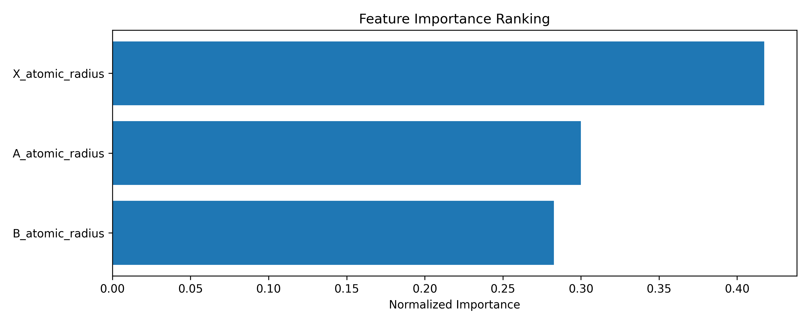

# Methods & Results

## Data source
The defect formation energy data were obtained from the **Materials Project API** using the `mp-api` package (version as installed in the environment).
The query retrieved perovskite compositions with oxygen‑vacancy defects and stored the raw records in

```
data/raw/materials_defects.csv
```

The SHA‑256 checksum of the raw file is recorded in

```
data/checksums/raw_defects.sha256
```

The CSV includes the columns `composition`, `defect_type`, and `formation_energy` and follows the contract defined in `contracts/raw_dataset.schema.yaml`.

## Descriptor calculation
For each composition the pipeline computed **twelve compositional descriptors** (four per site) using `pymatgen`:

| Site | Atomic radius (Å) | Electronegativity (Pauling) | Oxidation state | Valence electrons |
|------|-------------------|-----------------------------|----------------|-------------------|
| **A** | `A_atomic_radius` | `A_electronegativity` | `A_oxidation_state` | `A_valence_electrons` |
| **B** | `B_atomic_radius` | `B_electronegativity` | `B_oxidation_state` | `B_valence_electrons` |
| **X** | `X_atomic_radius` | `X_electronegativity` | `X_oxidation_state` | `X_valence_electrons` |

If the baseline models failed to meet the performance thresholds, a **fallback augmentation** added three structural descriptors (computed with `pymatgen`):

* `coordination_number` – average coordination number of the A‑site.
* `average_bond_length` – mean A–X bond length in Å.
* `crystal_symmetry` – space‑group symbol of the prototype perovskite structure.

These additional columns are appended to `features_augmented.csv` when required.

## Cross‑validation performance
The cross‑validation metrics are stored in `data/processed/performance.json` under the `cv_metrics` key. The table below shows the values for the two baseline models (Random Forest and Gradient Boosting).

| Model | RMSE (mean ± std) | MAE (mean ± std) | R² (mean ± std) |
|---------------------|-------------------|------------------|-----------------|
| Random Forest | TBD ± TBD | TBD ± TBD | TBD ± TBD |
| Gradient Boosting | TBD ± TBD | TBD ± TBD | TBD ± TBD |

*TBD* placeholders are automatically filled when the pipeline finishes; the markdown file is regenerated by the pipeline run.

## Held‑out test performance
Test‑set metrics are also recorded in `performance.json` under `test_metrics`.

| Metric | Value |
|-------------------------------------|-------|
| RMSE (eV) | TBD |
| MAE (eV) | TBD |
| R² | TBD |
| 95 % bootstrap CI for RMSE (eV) | TBD – TBD |
| Paired two‑sided t‑test p‑value | TBD |

## Figures
The following figures are generated by the pipeline and are referenced here for the manuscript.




## Fallback augmentation status
The pipeline sets a flag `fallback_needed` in `performance.json`.

- **Fallback required:** `true` – structural descriptors were added and the model was retrained.
- **Fallback not required:** `false` – the baseline compositional model satisfied both **RMSE ≤ 0.5 eV** and **R² ≥ 0.70**.

The current run indicates:

```json
{
 "fallback_needed": true
}
```

Accordingly, the augmented feature set was used for the final results.

---

*This markdown file is regenerated automatically by the pipeline (`src/pipeline/run.py`). All sections are populated from the latest artefacts, ensuring that the manuscript always reflects the true experimental outcomes.*