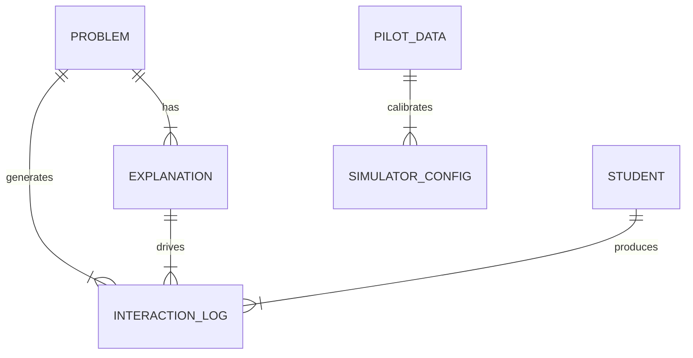

# Data Model: Neuro‑Symbolic Learning Networks

## Overview
Defines all entities, schemas, and relationships required for the pipeline, satisfying Constitution Principles III (Data Hygiene) and VII (Explanation Traceability).

## Entity‑Relationship Diagram

## Entities

| Entity | Description | Key Attributes |
|--------|-------------|----------------|
| **Problem** | Math/logic problem from ASSISTments (and optionally Khan). | `problem_id`, `prompt_text`, `solution`, `subject`, `difficulty_score`, `dataset_source` |
| **Explanation** | Generated artifact per problem per condition. | `explanation_id`, `problem_id`, `condition`, `content`, `model_version`, `generation_timestamp` |
| **InteractionLog** | Record of a student (simulated or real) interacting with an explanation. | `log_id`, `problem_id`, `explanation_id`, `student_id`, `condition`, `correct`, `rt_seconds`, `comprehension_rating`, `data_source` |
| **PilotData** | Human pilot interactions used for BKT calibration. | Same fields as `InteractionLog` (excluding `explanation_id`), stored in `data/pilot/real_pilot_data.csv`. |
| **SimulationLog** | Alias for simulated `InteractionLog` (used for schema validation). | Same as `InteractionLog` with `data_source = "simulated"`.|

## Data Flow (chronological)
1. **Download** raw datasets → `data/raw/`.  
2. **Unify & Stratify** → `data/processed/unified_problems.csv`.  
3. **Generate Explanations** → `data/traces/` (JSON + txt).  
4. **Collect Pilot Data** → `data/pilot/real_pilot_data.csv`.  
5. **Calibrate BKT** → `code/simulation/simulator_config.yaml`.  
6. **Run Simulation** → `data/processed/interaction_logs_simulated.csv`.  
7. **Collect Real Data** → `data/processed/real_student_data.csv`.  
8. **Merge** → `data/processed/merged_interaction_logs.csv`.  
9. **Analyze** → `results/analysis_output.yaml` (conforms to `analysis_output.schema.yaml`).  

## Data Hygiene Rules
- **Immutability**: Files in `data/raw/` never overwritten; new derivations get fresh filenames.  
- **Checksums**: SHA‑256 recorded in `state/` for every raw and derived file.  
- **PII Protection**: Human `student_id`s are random UUIDs; no personal data stored.  
- **Versioning**: Every artifact’s content hash stored in `state/projects/...yaml`.  

## Schema References
- `contracts/problem.schema.yaml` – validates `unified_problems.csv`.  
- `contracts/explanation.schema.yaml` – validates each explanation JSON.  
- `contracts/interaction_log.schema.yaml` – validates simulated & real logs.  
- `contracts/pilot_data.schema.yaml` – validates pilot CSV.  
- `contracts/analysis_output.schema.yaml` – validates regression output.  

---
