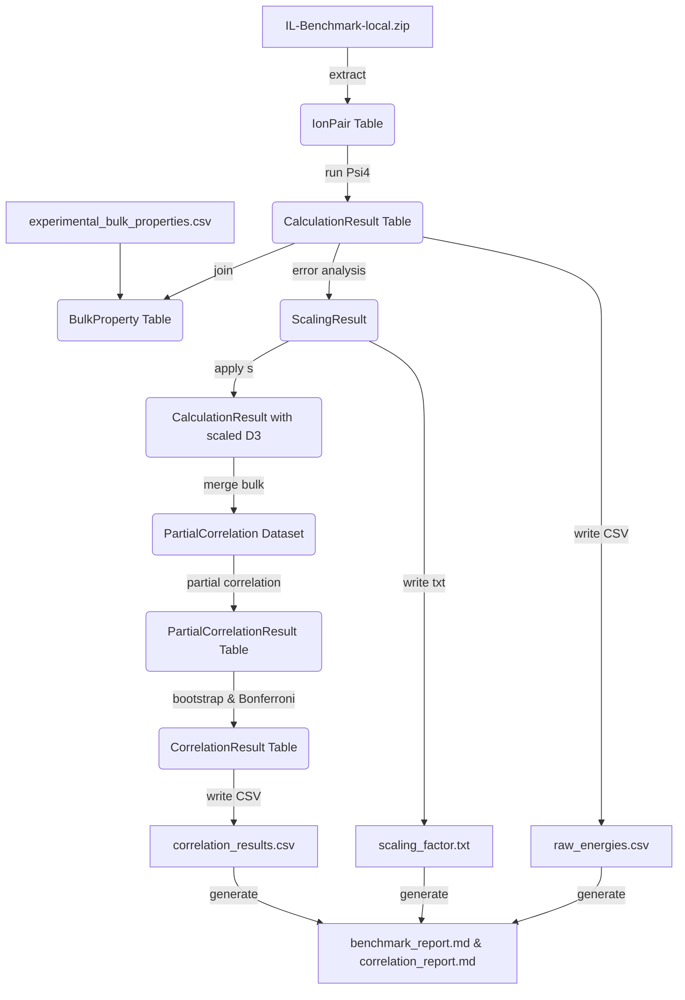

# Data Model: Transferability of DFT‑D3 Dispersion to Ionic Liquids

## Overview
Defines all data structures, schemas, and transformation pathways from raw inputs to final reports. Every artifact is immutable or version‑controlled, satisfying the Constitution’s Data Hygiene and Single‑Source‑of‑Truth principles.

## Entities

| Entity | Description | Fields |
|--------|-------------|--------|
| **IonPair** (raw) | One ion‑pair complex from the benchmark set; includes a `cluster_id` to capture shared cation/anion groups. | `pair_id` (str), `xyz_path` (str), `reference_energy` (float, kcal mol⁻¹), `cations` (str), `anions` (str), `cluster_id` (str) |
| **CalculationResult** (derived) | Holds `dft_total_energy`, `d3_dispersion_energy`, `bsse_correction`, and error metrics. | `pair_id` (str), `dft_total_energy` (float), `d3_dispersion_energy` (float), `bsse_correction` (float), `calculation_status` (enum: success/failed/skipped), `error_signed` (float), `dispersion_only_error` (float) |
| **BulkProperty** (raw) | Experimental bulk data for an ion pair. | `pair_id` (str), `density` (float, g/cm³), `viscosity` (float, cP), `source` (str) |
| **ScalingResult** (derived) | Scalar correction for the D3 term, with cross‑validation statistics. | `scaling_factor` (float > 0), `ci_lower` (float), `ci_upper` (float), `p_value` (float), `mae_original` (float), `mae_corrected_train` (float), `mae_corrected_test` (float) |
| **PartialCorrelationResult** (derived) | Result of a partial correlation controlling for electrostatic energy and size. | `test_name` (str), `method` (enum: Pearson/Spearman), `coefficient` (float), `r_squared` (float), `p_value` (float), `p_value_bonferroni` (float), `ci_lower` (float), `ci_upper` (float), `n_samples` (int), `is_significant` (bool) |
| **CorrelationResult** (derived) | Mirrors the CSV output; each row corresponds to a (partial) correlation test. | `metric_name` (str), `coefficient` (float), `r_squared` (float), `p_value` (float), `p_value_bonferroni` (float), `ci_lower` (float), `ci_upper` (float), `n_samples` (int), `is_significant` (bool) |

## File Specifications

| File | Location | Format | Schema |
|------|----------|--------|--------|
| `IL‑Benchmark‑local.zip` | `data/raw/` | ZIP (contains `metadata.csv` + `xyz/` files) | – |
| `metadata.csv` | inside ZIP | CSV | Columns: `pair_id`, `xyz_file`, `reference_energy`, `cations`, `anions` |
| `experimental_bulk_properties.csv` | `data/raw/` | CSV | Columns: `pair_id`, `density`, `viscosity` |
| `raw_energies.csv` | `data/derived/` | CSV | **Schema**: `contracts/raw_energies.schema.yaml` |
| `scaling_factor.txt` | `data/derived/` | Text (JSON block) | **Schema**: `contracts/scaling_factor.schema.yaml` |
| `correlation_results.csv` | `data/derived/` | CSV | **Schema**: `contracts/correlation_results.schema.yaml` |
| `correlation_report.md` | `docs/` | Markdown (JSON representation) | **Schema**: `contracts/correlation_report.schema.yaml` |
| `benchmark_report.md` | `docs/` | Markdown | Human‑readable summary of raw error metrics and MAE CI |
| `lint_report.txt` | `code/` | Text | Contains flake8 output; must end with `Exit code: 0` |

## Data Flow Diagram

## Constraints
- **Immutability**: Files under `data/raw/` are never overwritten. Derived files are written to `data/derived/` with a timestamped version if regenerated.  
- **Missing Data Handling** (`FR‑002`, edge cases): Records lacking `reference_energy` or `pair_id` are logged and omitted; bulk properties missing for a pair cause that pair to be excluded from correlation (still retained for raw error analysis).  
- **Unit Consistency**: Energies in kcal mol⁻¹, densities in g cm⁻³, viscosities in cP.  
- **Checksum Recording**: SHA‑256 hashes of all raw and derived files are stored in `state/projects/...yaml` for reproducibility verification.  

## Alignment with Specification
- **FR‑008** is satisfied by the explicit NIST API attempt (see Phase 1 of the plan).  
- The merged dataset used in Phase 5 conforms to the `BulkProperty` entity, ensuring schema consistency (plan_consistency‑c441f589).  
- The new `PartialCorrelationResult` entity captures the controlled statistical analysis required to address confounding (methodology‑f7256fa5).  

---

