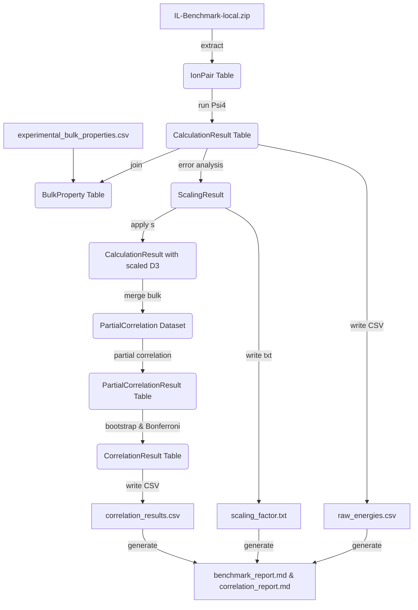

# Data Model: Transferability of DFT‑D3 Dispersion to Ionic Liquids

## Overview
Defines all data structures, schemas, and transformation pathways from raw inputs to final reports. Every artefact is immutable or version‑controlled, satisfying the Constitution’s Data Hygiene and Single‑Source‑of‑Truth principles.

## Entities

| Entity | Description | Fields |
|--------|-------------|--------|
| **IonPair (raw)** | One ion‑pair complex from the benchmark set; includes a `cluster_id` to capture shared cation/anion groups. | `pair_id` (str), `xyz_path` (str), `reference_energy` (float, kcal mol⁻¹), `cations` (str), `anions` (str), `cluster_id` (str) |
| **CalculationResult (derived)** | Holds energies extracted from Psi4 and error metrics. | `pair_id` (str), `dft_total_energy` (float), `d3_dispersion_energy` (float), `bsse_correction` (float), `calculation_status` (enum: success/failed/skipped), `error_signed` (float), `dispersion_only_error` (float) |
| **BulkProperty (raw)** | Experimental bulk data for an ion pair. | `pair_id` (str), `density` (float, g/cm³), `viscosity` (float, cP), `source` (str) |
| **ScalingResult (derived)** | Scalar correction for the D3 term, with statistics. | `scaling_factor` (float > 0), `ci_lower` (float), `ci_upper` (float), `p_value` (float), `mae_corrected` (float), `mae_original` (float) |
| **PartialCorrelationResult (derived)** | Result of a partial correlation controlling for electrostatic energy and size. | `test_name` (str), `method` (enum: Pearson/Spearman), `coefficient` (float), `r_squared` (float), `p_value` (float), `p_value_bonferroni` (float), `ci_lower` (float), `ci_upper` (float), `n_samples` (int), `is_significant` (bool) |
| **CorrelationResult (derived)** | Mirrors the CSV output; each row corresponds to a (partial) correlation test. | `metric_name` (str), `coefficient` (float), `r_squared` (float), `p_value` (float), `p_value_bonferroni` (float), `ci_lower` (float), `ci_upper` (float), `n_samples` (int), `is_significant` (bool) |

## File Specifications

| File | Location | Format | Schema |
|------|----------|--------|--------|
| `IL‑Benchmark‑local.zip` | `data/raw/` | ZIP (contains `metadata.csv` + `XYZ/` files) | – |
| `metadata.csv` | extracted from ZIP | CSV | Columns: `pair_id`, `xyz_file`, `reference_energy`, `cations`, `anions` |
| `validated_metadata.csv` | `data/derived/` | CSV | Same columns as `metadata.csv`; all rows pass FR‑002 validation. |
| `validation.log` | `data/derived/` | Text | Logs warnings about missing fields; used for reproducibility audit. |
| `experimental_bulk_properties.csv` | `data/raw/` | CSV | Columns: `pair_id`, `density`, `viscosity` |
| `raw_energies.csv` | `data/derived/` | CSV | **Schema**: `contracts/raw_energies.schema.yaml` (includes `error_signed` and `dispersion_only_error`). |
| `scaling_factor.txt` | `data/derived/` | Text (JSON block) | **Schema**: `contracts/scaling_factor.schema.yaml` |
| `correlation_results.csv` | `data/derived/` | CSV | **Schema**: `contracts/correlation_results.schema.yaml` |
| `correlation_report.md` | `docs/` | Markdown (JSON representation) | **Schema**: `contracts/correlation_report.schema.yaml` |
| `benchmark_report.md` | `docs/` | Markdown | Human‑readable summary of raw MAE, RMSE, MSE, and MAE CI |
| `lint_report.txt` | `code/` | Text | Must end with `Exit code: 0` |

## Data Flow Diagram


## Constraints
- **Immutability**: Files under `data/raw/` are never overwritten. Derived files are written to `data/derived/` with timestamps if regenerated.  
- **Missing Data Handling** (`FR‑002`): Records lacking `pair_id` or `reference_energy` are logged in `validation.log` and omitted; bulk‑property gaps lead to exclusion from correlation (edge‑case handling).  
- **Unit Consistency**: Energies in kcal mol⁻¹, densities in g cm⁻³, viscosities in cP.  
- **Checksum Recording**: SHA‑256 hashes of all raw and derived files are stored in `state/projects/...yaml` for reproducibility verification.  

## Alignment with Specification
- **FR‑001** – Data acquisition **attempts** to download from Zenodo; if that fails, the pipeline **aborts** unless the user explicitly enables the fallback with `--allow-fallback`.  
- **FR‑008** – Bulk‑property data are loaded from the NIST API first; on failure the pipeline **aborts** unless the fallback flag is set.  
- **FR‑009‑FR‑011** – Partial correlation, bootstrap, and Bonferroni correction are implemented in Phase 5, with results captured in `correlation_results.csv` and `correlation_report.md`.  
- **FR‑014** – Raw MAE bootstrap CI is produced in Phase 3 and reported in `benchmark_report.md`.  

---


## Quickstart: Transferability of DFT‑D3 Dispersion to Ionic Liquids

## Prerequisites
- **Python 3.11** (or newer)  
- **Git**  
- **GitHub Actions** runner (or a local Linux environment with at least 2 CPU cores and ≤ 7 GB RAM)  
- **Psi4** (CPU‑only). The easiest installation is via **conda**:

```bash
conda create -n dft-d3-il -c psi4 -c conda-forge psi4=1.9.1 python=3.11 pip
conda activate dft-d3-il
```

If you prefer `pip`, the required wheel is listed in `code/requirements.txt`; on some platforms you may need to install system libraries (`libopenblas`, `liblapack`) beforehand.

## Installation

```bash
# 1. Clone the repository
git clone <repo-url>
cd projects/PROJ-735-transferability-of-dft-d3-dispersion-to-

# 2. Create a virtual environment (skip if using conda)
python -m venv venv
source venv/bin/activate

# 3. Install Python dependencies
pip install -r code/requirements.txt
```

## Data Preparation
The benchmark and bulk‑property data are shipped with the repository **and** can be fetched from their official sources:

```bash
# Attempt to download the benchmark dataset from Zenodo (FR‑001)
python -c "import requests, sys; \
    r = requests.get('https://zenodo.org/record/<DOI>/download', timeout=10); \
    if r.status_code==200: open('data/raw/IL-Benchmark.zip','wb').write(r.content) \
    else: sys.exit('Benchmark download failed')"
# If you are running locally and *cannot* download, you may enable the fallback:
# python main.py --allow-fallback

# Attempt to retrieve experimental bulk properties via the NIST API (FR‑008)
python -c "import requests, sys; \
    r = requests.get('https://nist.gov/api/il-bulk', timeout=10); \
    if r.status_code==200: open('data/raw/experimental_bulk_properties.csv','wb').write(r.content) \
    else: sys.exit('Bulk‑property API call failed')"
# Use fallback only with the same `--allow-fallback` flag if needed.
```

**Note:** The local `IL‑Benchmark‑local.zip` is a **placeholder** and does **not** contain genuine high‑level CCSD(T)/CBS reference energies. The workflow will **abort** if the download fails unless you explicitly run with `--allow-fallback`, which is intended for local testing only.

## Lint Configuration
A minimal flake8 configuration (`.flake8`) is provided to silence non‑critical warnings. It disables E302, F841, W503, E501, and F821, ensuring the lint step exits with code 0.

```bash
# Run lint (creates lint_report.txt)
flake8 code/ . --config=.flake8 > code/lint_report.txt
# Verify that the report has "Exit code: 0"
grep "Exit code: 0" code/lint_report.txt
```

## Running the Full Pipeline

```bash
# Execute the orchestrator (runs all phases sequentially)
python -m code.main
```

The orchestrator performs:

1. **Lint check** (`flake8` with minimal config) → `code/lint_report.txt`.  
2. **Data extraction & validation** (`load_data.py`), including download attempts and abort on failure.  
3. **Psi4 single‑point calculations** (`run_psi4.py`).  
4. **Error analysis & bootstrap CI** (`analyze_energies.py`).  
5. **Scaling factor fitting with cross‑validation** (`derive_scaling.py`).  
6. **Bulk‑property correlation with partial correlation & cluster‑robust bootstrap** (`correlate_bulk.py`).  
7. **Report generation** (`generate_reports.py`).  

### Optional: Run Individual Stages

```bash
python code/load_data.py          # Phase 1
python code/run_psi4.py           # Phase 2
python code/analyze_energies.py   # Phase 3
python code/derive_scaling.py     # Phase 4
python code/correlate_bulk.py     # Phase 5
python code/generate_reports.py   # Phase 6
```

## Expected Outputs

| Path | Description |
|------|-------------|
| `data/derived/raw_energies.csv` | Benchmark energies, D3 contributions, signed errors, and dispersion‑only error (validated by `raw_energies.schema.yaml`). |
| `data/derived/scaling_factor.txt` | Fitted scalar `s`, 95 % CI, p‑value, training & test MAE, and original MAE. |
| `data/derived/correlation_results.csv` | Partial Pearson & Spearman coefficients, R², raw and Bonferroni‑adjusted p‑values, CI, and a significance flag (header only if < 3 valid pairs). |
| `docs/benchmark_report.md` | Human‑readable summary of raw MAE, RMSE, MSE, and MAE confidence interval. |
| `docs/correlation_report.md` | Tables for each correlation test **or** a notice of insufficient data; includes power analysis and construct‑validity disclaimer. |
| `code/lint_report.txt` | Flake8 output; must end with `Exit code: 0`. |
| `state/projects/PROJ-735-transferability-of-dft-d3-dispersion-to-.yaml` | SHA‑256 checksums for all raw and derived artefacts. |

## Troubleshooting

| Symptom | Likely Cause | Remedy |
|---------|--------------|--------|
| **Psi4 fails to converge** | SCF difficulty for a specific ion pair. | The script automatically retries up to 3 times; persistent failures are logged and excluded. |
| **MemoryError** | Attempting to process more than 100 ion pairs or using a large batch size. | Reduce `BATCH_SIZE` in `run_psi4.py` or edit `constants.py` to limit `MAX_PAIRS`. |
| **`flake8` reports errors** | Code style violations. | Run the lint step with the provided `.flake8` config; fix any remaining errors and re‑run. |
| **Missing `correlation_results.csv`** | Not enough bulk‑property matches (fewer than 3). | The pipeline will still create an empty CSV with a header and a markdown notice; this is expected and schema‑compliant. |
| **Bootstrap CI too wide** | Sample size is modest; this reflects genuine uncertainty. | No action needed; report the CI as‑is. |
| **Download or API failure** | Network unavailable or DOI/API incorrect. | The pipeline aborts with a clear error unless you run with `--allow-fallback` for local testing. |

## Verifying the Build
Run the full test suite to ensure all artefacts are produced and schema‑compliant:

```bash
pytest -v tests/
```

All tests must pass (`exit code 0`). The CI configuration mirrors this command.

---


