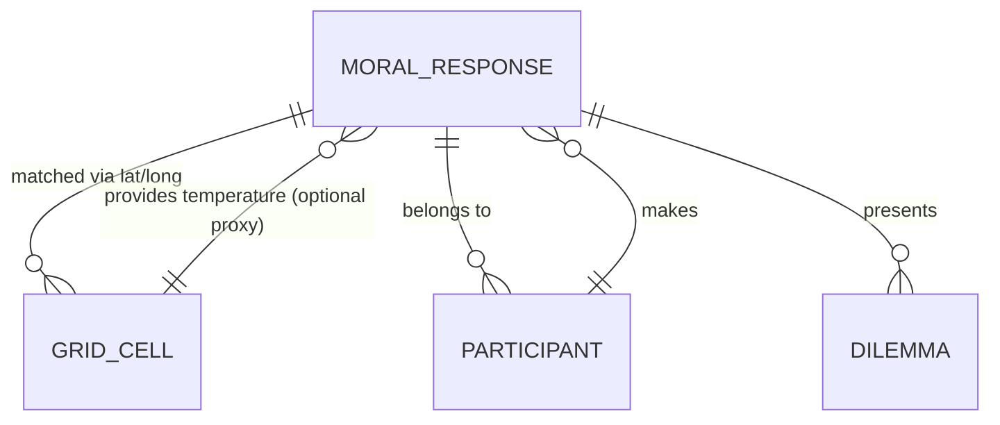

# Data Model: Ambient Temperature Influence on Moral Decision Speed (Re‑scoped)

## 1. Entity Relationship (Textual)

## 2. Schema Definitions

### 2.1. Raw Moral Machine Data (`data/raw/moral_machine.csv`)

| Column | Type | Description | Constraints |
|--------|------|-------------|-------------|
| `response_id` | STRING | Unique row identifier | PK |
| `participant_id` | STRING | Anonymous participant ID | |
| `country` | STRING | ISO‑country code | |
| `latitude` | FLOAT | Decimal latitude | NOT NULL |
| `longitude` | FLOAT | Decimal longitude | NOT NULL |
| `timestamp` | TIMESTAMP | UTC timestamp of decision | NOT NULL |
| `response_time_ms` | INTEGER | **Required** response latency in milliseconds | NOT NULL |
| `choice` | STRING | `"utilitarian"` or `"non_utilitarian"` | NOT NULL |
| `dilemma_id` | INTEGER | Scenario identifier | |
| `age_group` | STRING | Age bracket (optional) | |
| `gender` | STRING | Gender (optional) | |

### 2.2. ERA5 Climate Grid (`data/raw/era5_2014_2018.h5`)

| Column | Type | Description | Constraints |
|--------|------|-------------|-------------|
| `grid_id` | STRING | Unique grid cell identifier | |
| `latitude` | FLOAT | Center latitude of cell | |
| `longitude` | FLOAT | Center longitude of cell | |
| `temperature_c` | FLOAT | Hourly 2 m air temperature (°C) for 2014‑2018 | -50 ≤ temp ≤ 50 |

### 2.3. Processed Merged Dataset (`data/processed/merged_dataset.parquet`)

| Column | Type | Description | Source |
|--------|------|-------------|--------|
| `record_id` | STRING | `{response_id}_{grid_id}` composite | Derived |
| `response_id` | STRING | From Moral Machine | MM |
| `participant_id` | STRING | From Moral Machine | MM |
| `country` | STRING | From Moral Machine | MM |
| `latitude` | FLOAT | From Moral Machine (kept) | MM |
| `longitude` | FLOAT | From Moral Machine | MM |
| `response_time_ms` | INTEGER | From Moral Machine (required) | MM |
| `log_rt` | FLOAT | `log(response_time_ms)` | Derived |
| `temperature_c` | FLOAT | Hourly temperature from ERA5 (required primary predictor) | ERA5 |
| `temperature_c_squared` | FLOAT | Square of `temperature_c` for non‑linearity test | Derived |
| `distance_km` | FLOAT | Haversine distance to nearest ERA5 grid cell | Derived |
| `dilemma_complexity` | FLOAT | Static score based on lives at stake | Derived |
| `time_of_day` | INTEGER | Hour of day (0‑23) extracted from `timestamp` | Derived |
| `age_group` | STRING | Optional | MM |
| `gender` | STRING | Optional | MM |
| `urban_rural_proxy` | STRING | `"urban"` / `"rural"` (optional, from WorldPop) | Optional |
| `quality_flag` | STRING | Data quality status (`OK`, `LOW_CONF`, `EXCLUDED`) | Enum |

### 2.4. Data Quality Log (`data/processed/data_quality_log.json`)

Conforms to `contracts/exclusion_log.schema.yaml`. Each entry records `response_id`, reason for exclusion, original coordinates, and timestamp.

## 3. Data Flow

1. **Download Moral Machine CSV** (`code/download_moral_machine.py`).  
2. **Download Hourly ERA5 (2014‑2018)** (`code/download_era5.py`).  
3. **Validate Sources** (`code/validate_sources.py`) – aborts if ERA5 is not hourly (FR‑014).  
4. **(Optional) Download WorldPop raster** (`code/download_worldpop.py`).  
5. **Ingest & Match** (`code/ingestion.py`): nearest‑grid join (lat/long only), compute haversine distance, flag > 100 km (FR‑009), merge hourly temperature.  
6. **Preprocess** (`code/preprocessing.py`): verify `response_time_ms` presence, filter implausible RTs, encode `choice_binary`, derive covariates, write `merged_dataset.parquet`.  
7. **Fit Primary Mixed‑Effects Model** (`code/modeling.py`): MixedLM on `log_rt` with random intercepts for `participant_id` and `cultural_region`, diagnostics, write `model_output.json` (`contracts/model_output.schema.yaml`).  
8. **Robustness Analyses** (`code/robustness.py`): alternative temperature metric (3‑hour moving average), temperature outlier thresholds, indoor/outdoor proxy (if WorldPop available); produce `sensitivity_analysis.csv`.  

All artifacts are validated against the schemas in `contracts/`.

## 4. Constraints & Rules (Re‑scoped)

| Rule | Implementation |
|------|----------------|
| Temperature source | Hourly ERA5 2014‑2018 (verified; grid resolution at a sub-degree scale.). |
| Response‑time requirement | Mandatory `response_time_ms`; pipeline aborts if missing (FR‑003, FR‑010). |
| Latitude as primary predictor | **Removed**; temperature is primary predictor. |
| Indoor/outdoor confound | Optional WorldPop raster; if unavailable, analysis logs limitation and proceeds with sensitivity check (FR‑012). |
| Reproducibility | Random seeds pinned; deterministic data fetching. |
| Data Hygiene | Raw files immutable; derived files new filenames; checksums stored. |

---

