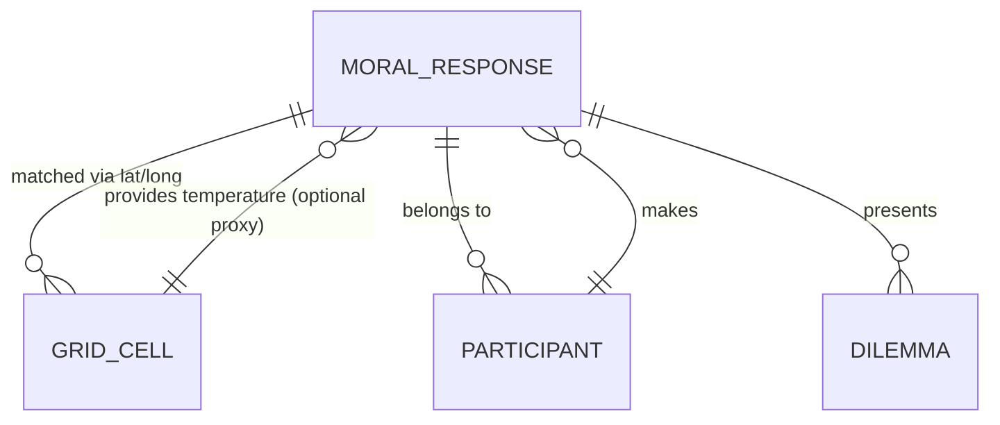

# Data Model: Ambient Temperature Influence on Moral Decision Speed (Re‑scoped)

## 1. Entity Relationship (Textual)

## 2. Schema Definitions

### 2.1. Raw Moral Machine Data (`data/raw/moral_machine.csv`)

| Column | Type | Description | Constraints |
|--------|------|-------------|-------------|
| `response_id` | STRING | Unique row identifier | PK |
| `participant_id` | STRING | Anonymous participant ID | |
| `country` | STRING | ISO‑country code | |
| `latitude` | FLOAT | Decimal latitude | NOT NULL |
| `longitude` | FLOAT | Decimal longitude | NOT NULL |
| `timestamp` | TIMESTAMP | UTC timestamp of decision | NOT NULL |
| `choice` | STRING | `"utilitarian"` or `"non_utilitarian"` (derived) | NOT NULL |
| `dilemma_id` | INTEGER | Scenario identifier | |
| `age_group` | STRING | Age bracket (optional) | |
| `gender` | STRING | Gender (optional) | |
| `response_time_ms` | INTEGER | *Not used* – absent in source (documented) | |

### 2.2. ERA5 Climate Grid (`data/raw/era5_1982.h5`)

| Column | Type | Description | Constraints |
|--------|------|-------------|-------------|
| `grid_id` | STRING | Unique grid cell identifier | |
| `latitude` | FLOAT | Center latitude of cell | |
| `longitude` | FLOAT | Center longitude of cell | |
| `temperature_c` | FLOAT | Mean 2 m air temperature (°C) for 1982 | -40 ≤ temp ≤ 50 |

### 2.3. Processed Merged Dataset (`data/processed/merged_dataset.parquet`)

| Column | Type | Description | Source |
|--------|------|-------------|--------|
| `record_id` | STRING | `{response_id}_{grid_id}` composite | Derived |
| `response_id` | STRING | From Moral Machine | MM |
| `participant_id` | STRING | From Moral Machine | MM |
| `country` | STRING | From Moral Machine | MM |
| `latitude` | FLOAT | From Moral Machine (kept as covariate) | MM |
| `longitude` | FLOAT | From Moral Machine | MM |
| `choice_binary` | INTEGER | 1 = utilitarian, 0 = non‑utilitarian | Derived |
| `temperature_c` | FLOAT | Mean annual temperature from ERA5 1982 grid (optional proxy) | ERA5 |
| `distance_km` | FLOAT | Haversine distance to nearest ERA5 grid cell | Derived |
| `dilemma_complexity` | FLOAT | Static score (e.g., lives at stake) | Derived |
| `time_of_day` | INTEGER | Hour of day (0‑23) extracted from `timestamp` | Derived |
| `age_group` | STRING | Optional | MM |
| `gender` | STRING | Optional | MM |
| `latitude_covariate` | FLOAT | Duplicate of `latitude` for modeling convenience | Derived |
| `urban_rural_proxy` | STRING | `"urban"` or `"rural"` derived from WorldPop density (mandatory proxy) | Derived |
| `quality_flag` | STRING | Data quality status | Derived |
| `quality_flag` | STRING | `"OK"`, `"LOW_CONF"`, `"EXCLUDED"` | Enum |

### 2.4. Data Quality Log (`data/processed/data_quality_log.json`)

Conforms to `contracts/exclusion_log.schema.yaml`. Each entry records the `response_id`, reason for exclusion, original coordinates, and timestamp.

## 3. Data Flow

1. **Download Moral Machine CSV** (`code/download_moral_machine.py`) – uses verified URL.  
2. **Validate Sources** (`code/validate_sources.py`) – checksums; **rejects** any external source lacking hourly resolution (e.g., ERA5 1982) and aborts with an informative error (FR‑014).  
3. **Download WorldPop Raster** (`code/download_worldpop.py`) – mandatory indoor/outdoor proxy; abort if unavailable.  
4. **Ingest & Match** (`code/ingestion.py`): nearest‑grid join (latitude/longitude only), compute haversine distance, flag > 100 km (FR‑009), validate against `contracts/merged_dataset.schema.yaml`.  
5. **Preprocess** (`code/preprocessing.py`): filter by distance, encode `choice_binary`, derive `time_of_day`, `dilemma_complexity`, duplicate `latitude` as `latitude_covariate`, create `urban_rural_proxy`, write `merged_dataset.parquet`.  
6. **Fit Primary Model** (`code/modeling.py`): read parquet, fit GLM‑Binomial with cluster‑robust SE, diagnostics (Hosmer‑Lemeshow, calibration, Pearson residuals), write `model_output.json` (conforms to `contracts/model_output.schema.yaml`).  
7. **Robustness Analyses** (`code/robustness.py`): (a) alternative temperature metric – 3‑hour moving‑average approximated by averaging neighboring grid cells (if proxy retained); (b) outlier threshold sweep; (c) indoor/outdoor adjustment using WorldPop raster; produce `sensitivity_analysis.csv`.  

All steps produce artifacts validated against the schemas in `contracts/`.

## 4. Constraints & Rules (Re‑scoped)

| Rule | Implementation |
|------|----------------|
| **Temperature Proxy Scope‑Limited** | Used only for optional exploratory checks; not required for primary model. |
| **Latitude as Primary Climate Covariate** | Included as `latitude_covariate` fixed effect to control for spatial climate gradients. |
| **Hourly Resolution Requirement** | Enforced in `validate_sources.py`; non‑hourly sources cause pipeline abort (FR‑014). |
| **WorldPop Indoor/Outdoor Proxy** | Mandatory; abort if raster cannot be obtained. |
| **Reproducibility** | Random seeds pinned in `config.py`; all data fetched from the same URLs on every run. |
| **Data Hygiene** | Raw files immutable; derived files receive new filenames; checksums stored in `data/external/checksums.txt`. |

---

