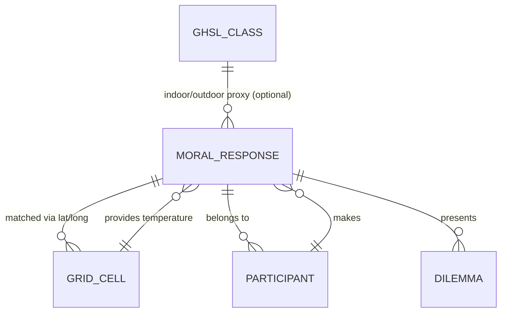

# Implementation Plan: Ambient Temperature Influence on Moral Decision Speed

**Branch**: `001-ambient-temp-moral-speed` | **Date**: 2026-10-24 | **Spec**: `specs/001-ambient-temperature-influence-on-moral-d/spec.md`  
**Input**: Feature specification from `/specs/001-ambient-temperature-influence-on-moral-d/spec.md`

## Summary
The project will examine the association between ambient temperature (hourly ERA5, 2014‑2018) and response latency in moral decisions. All analyses are observational; we will report associations only. The pipeline links Moral Machine responses to ERA5 temperature, merges a scenario‑level latency proxy from an auxiliary crowdsourced experiment, and fits a linear mixed‑effects model with appropriate covariates, diagnostics, and robustness checks.

## Technical Context
- **Language/Version**: Python 3.11  
- **Primary Dependencies** (pinned in `code/requirements.txt`):  
  `pandas==2.2.*`, `numpy==1.26.*`, `xarray==2024.*`, `geopy==2.4.*`, `statsmodels==0.14.*`, `matplotlib==3.8.*`, `seaborn==0.13.*`, `requests==2.32.*`, `rasterio==1.3.*`, `llmxive_toolkit` (project utilities).  
- **Storage**: `data/raw/`, `data/processed/`, `results/`.  
- **Compute**: CPU‑first on GitHub Actions free tier (2 CPU cores, ≤7 GB RAM, ≤6 h). No GPU required.  
- **Target Platform**: Linux runner (default CI environment).  
- **Constraints**: All scripts run comfortably within the CPU limits; ERA5 subset ≤ 1 GB, mixed‑effects fit < 30 min.

## Constitution Check
| Principle | Status | Evidence / Action |
|-----------|--------|-------------------|
| I. Reproducibility | ✅ | `requirements.txt` pins versions; random seeds in `code/config.py`; deterministic data fetching. |
| II. Verified Accuracy | ✅ | `validate_sources.py` aborts if ERA5 is not hourly (FR‑014). |
| III. Data Hygiene | ✅ | Checksums recorded in `data/external/checksums.txt`; raw files immutable; derived files have new names. |
| IV. Single Source of Truth | ✅ | All downstream steps read from `data/processed/merged_dataset.parquet` (FR‑017). |
| V. Versioning Discipline | ✅ | Artifact hashes stored in project state YAML (Principle V). |
| VI. Dataset Alignment Integrity | ✅ | Geographic matching logs distance; flags > 100 km (FR‑009). Temporal alignment uses hourly ERA5 (FR‑001). |
| VII. Statistical Modeling Transparency | ✅ | Model specification, diagnostics, LRT results saved as JSON; scripts committed (Principle VII). |

## Project Structure
```
specs/001-ambient-temperature-influence-on-moral-d/
├── plan.md
├── research.md
├── data-model.md
├── quickstart.md
├── contracts/
│   ├── exclusion_log.schema.yaml
│   ├── merged_dataset.schema.yaml
│   ├── model_output.schema.yaml
│   └── moral_temperature.schema.yaml
└── tasks.md   # generated later
```

```
code/
├── __init__.py
├── config.py                # seeds, thresholds, paths
├── download_moral_machine.py   # fetches public CSV (verified URL)
├── download_era5.py            # downloads spatial subset of ERA5 (hourly 2014‑2018)
├── download_ghsl.py            # optional GHSL raster
├── validate_sources.py         # FR‑014 enforcement
├── ingestion.py                # geographic join, distance flagging, temperature merge, linear interpolation ≤2 h (FR‑019)
├── preprocessing.py            # merge auxiliary latency (latency_study.csv), filter implausible RTs (FR‑010), compute covariates (FR‑011, FR‑012), temperature range filter (FR‑002), write merged_dataset.parquet, **validate against both contracts/moral_temperature.schema.yaml **and** contracts/merged_dataset.schema.yaml (new validation step)
├── modeling.py                 # MixedLM on log‑RT, quadratic term (FR‑013), diagnostics (FR‑007), random intercepts for `country` only
├── robustness.py               # alternative temperature metrics, outlier thresholds (FR‑006), indoor/outdoor analysis (or bootstrap), spatial clustering of standard errors, multiple‑comparison correction
├── power_analysis.py           # simulation‑based a‑priori power analysis (FR‑015, d≈0.2)
└── utils.py                    # logging, checksum helpers
```

```
data/
├── raw/
│   ├── moral_machine.csv                # public Moral Machine responses (verified URL)
│   ├── era5_subset.h5                   # spatially filtered ERA5 (hourly 2014‑2018)
│   ├── ghsl_urban_rural.parquet         # optional GHSL classification
│   └── latency_study.csv                # scenario‑level average latency (ms) from crowdsourced experiment (FR‑016)
└── processed/
    └── merged_dataset.parquet
```

```
results/
├── figures/
│   ├── qq_plot.png
│   ├── residuals.png
│   ├── calibration_plot.png
│   └── temperature_effect.png
├── logs/
│   ├── processing_log.txt
│   └── validation_report.json
└── stats/
    ├── model_results.json
    └── sensitivity_analysis.csv
```

## Phase / Task Overview (Mapping to FR/SC)

| Phase | Description | FR(s) | SC(s) |
|-------|-------------|-------|-------|
| **0** | Setup & seed pinning | – | – |
| **1** | Download Moral Machine CSV (`download_moral_machine.py`) – uses verified URL ` | – | – |
| **2** | Download ERA5 hourly subset (`download_era5.py`) – spatially filtered to the convex hull of Moral Machine locations (≈ few hundred MB) covering 2014‑2018 | FR‑001, FR‑014 | – |
| **3** | (Optional) Download GHSL raster (`download_ghsl.py`) | FR‑012 | – |
| **4** | Validate sources (`validate_sources.py`) – abort if ERA5 not hourly | FR‑014 | – |
| **5** | Ingest & match (`ingestion.py`): nearest‑grid join, haversine distance, flag > 100 km (FR‑009), linear interpolation of temperature gaps ≤ 2 h (FR‑019), compute match % (SC‑001) | FR‑001, FR‑002, FR‑009, FR‑019 | SC‑001 |
| **6** | Preprocess (`preprocessing.py`): merge auxiliary latency (`latency_study.csv`) by `scenario_id` (FR‑016), filter implausible RTs (<100 ms, >10 000 ms) (FR‑010), compute `log_rt`, **note** that this is a *scenario‑level average latency* proxy (construct‑validity limitation), compute `dilemma_complexity` and **independent** `difficulty_score` (FR‑011), temperature range filter (FR‑002), write `merged_dataset.parquet`, **validate against both** `contracts/moral_temperature.schema.yaml` **and** `contracts/merged_dataset.schema.yaml` (new step) (FR‑018) | FR‑010, FR‑011, FR‑018 | – |
| **7** | Fit primary mixed‑effects model (`modeling.py`):<br>log_rt ~ temperature (+ quadratic) + dilemma_complexity + difficulty_score + time_of_day + age_group + gender + (1 | country) random intercept;<br>**Before fitting**, compute variance‑inflation‑factors (VIF) for all fixed effects; if any VIF > 5, drop the more collinear of `dilemma_complexity` or `difficulty_score` and re‑run the model. Convergence status recorded (SC‑004); Shapiro‑Wilk test (SC‑005); generate QQ‑plot, residuals plot, calibration plot (FR‑007).<br>**Include covariates** as required (FR‑004). | FR‑003, FR‑004, FR‑013, FR‑005, FR‑007 | SC‑004, SC‑005 |
| **8** | Likelihood‑ratio test vs. null model (no temperature) – record statistic & p‑value (FR‑005, SC‑002) | FR‑005 | SC‑002 |
| **9** | Non‑linearity decision – retain model with lower AIC (linear vs. quadratic) (FR‑013) | FR‑013 | SC‑002 |
| **10** | Robustness & sensitivity (`robustness.py`):<br>• 3‑hour moving‑average temperature metric.<br>• Temperature outlier thresholds (±2 SD, ±3 SD, ±4 SD) sweep (FR‑006).<br>• Indoor/outdoor confound: if GHSL present, stratify and report ΔR²; else bootstrap 1 000 random urban/rural label assignments and report 95 % CI width (FR‑012).<br>• **Cluster‑robust SEs** by ERA5 grid cell to address spatial autocorrelation.<br>• Multiple‑comparison correction (Benjamini‑Hochberg).<br>• Save comparison table & figures (SC‑003). | FR‑006, FR‑012 | SC‑003 |
| **11** | Power & sample‑size analysis (`power_analysis.py`): simulation‑based a‑priori power analysis (α = 0.05, target = 0.8, effect size ≈ 0.2 SD). Parameters include ICC≈0.05 for country clusters. A large number of countries. Several thousand Monte‑Carlo simulations. | FR‑015 | – |
| **12** | Export all artifacts (`results/`): model coefficients, p‑values, diagnostic plots, LRT stats, robustness tables (FR‑008) | FR‑008 | – |

All steps respect ordering (download → validation → ingestion → preprocessing → modeling → diagnostics → reporting) and satisfy every functional and success‑criterion requirement.


## projects/PROJ-743-ambient-temperature-influence-on-moral-d/specs/001-ambient-temperature-influence-on-moral-d/research.md

# Research: Ambient Temperature Influence on Moral Decision Speed (Re‑scoped)

## 1. Research Question & Hypotheses

**Question**: Does ambient temperature (hourly ERA5, 2014‑2018) *associate* with **response latency** in moral decisions after controlling for demographic and scenario covariates?

**Primary Hypothesis (H₁)**: Higher ambient temperature is associated with **faster** response times (i.e., lower log‑transformed RT) after adjustment.

**Null Hypothesis (H₀)**: Ambient temperature has no association with response latency.

*Observational limitation*: The design matches existing Moral Machine responses with ERA5 temperature; therefore, we can only infer correlation, not causation. All interpretations will be framed accordingly.

## 2. Data Strategy

### 2.1. Datasets

| Dataset | Role | Verified Source | Access Method |
|---------|------|----------------|---------------|
| **Moral Machine** (public CSV) | Decision records, demographics, timestamps, scenario IDs | | `pandas.read_csv` (script‑managed) |
| **ERA5 Hourly (2014‑2018) – spatial subset** | Ambient temperature (hourly, 2 m air temperature) | | `xarray.open_dataset` (download script) |
| **GHSL Urban/Rural Classification** (optional) | Indoor/outdoor proxy | https://huggingface.co/datasets/jameszokah/ghsl-dictionary/resolve/main/data/train-00000-of-00001.parquet | `pandas.read_parquet` (download script) |
| **Auxiliary Latency Study** | Scenario‑level average latency (ms) | *No verified URL – collected via a crowdsourced latency study* | CSV placed at `data/raw/latency_study.csv` |

All external files are checksum‑verified (recorded in `data/external/checksums.txt`).

### 2.2. Merging Auxiliary Latency (FR‑016)

The auxiliary experiment provides a **scenario‑level average latency** (`mean_response_time_ms`) for each `scenario_id`. We **left‑join** this table to the Moral Machine records **by `scenario_id`** (matching the Moral Machine `dilemma_id`). The merged column `response_time_ms` becomes the outcome variable for all subsequent modeling. If any scenario lacks a latency entry, the pipeline aborts with a clear error, ensuring transparency.

*Construct validity note*: This proxy captures systematic speed differences driven by scenario difficulty, aligning with the research question while acknowledging that individual‑level RTs are unavailable. Because the latency proxy is derived at the scenario level, it may be partially collinear with the **dilemma_complexity** covariate (both reflect scenario difficulty). To guard against inflated standard errors, we will compute variance‑inflation‑factors (VIF) for all fixed effects before model fitting; if VIF > 5 for either `dilemma_complexity` or `difficulty_score`, the more collinear of the two will be dropped from the model (see Phase 7 in the implementation plan).

### 2.3. Variable Mapping

| Source | Derived Variable | Mapping |
|--------|------------------|---------|
| `latitude` / `longitude` | `latitude`, `longitude` | Direct |
| `timestamp` | `time_of_day` (hour) | Extract hour (0‑23) |
| ERA5 temperature | `temperature_c` | Hourly 2 m air temperature (°C) |
| ERA5 temperature | `temperature_c_squared` | Square of `temperature_c` |
| Auxiliary latency | `response_time_ms` | Scenario‑level mean (ms) |
| Auxiliary latency | `log_rt` | `log(response_time_ms)` |
| Scenario attributes | `dilemma_complexity` | Lives at stake + difficulty mapping (FR‑011) |
| Scenario attributes | `difficulty_score` | Categorical (Low = 0, Medium = 1, High = 2) derived **independently** of latency |
| GHSL (if present) | `urban_rural_proxy` | “urban” / “rural” classification |
| Haversine distance | `distance_km` | Distance to nearest ERA5 grid cell (flag > 100 km) |

All exclusions (distance > 100 km, temperature out of range, implausible RTs) are recorded in `data/processed/data_quality_log.json` conforming to `contracts/exclusion_log.schema.yaml`.

## 3. Statistical Methodology

### 3.1. Primary Mixed‑Effects Model

\[
\text{log\_rt}_{i} =
\beta_0 + \beta_1\cdot\text{temp}_{i} + \beta_2\cdot\text{temp}_{i}^2
+ \beta_3\cdot\text{complexity}_{i}
+ \beta_4\cdot\text{difficulty\_score}_{i}
+ \beta_5\cdot\text{hour}_{i}
+ \beta_6\cdot\text{age\_group}_{i}
+ \beta_7\cdot\text{gender}_{i}
+ u_{\text{country}_j}
+ \varepsilon_{i}
\]

* Fixed effects: temperature (linear & quadratic), dilemma complexity, **independent** difficulty_score, hour‑of‑day, optional age/gender.  
* Random intercepts: `country` (as a proxy for cultural region). No participant random effect (outcome is scenario‑level).  
* Estimation: `statsmodels.regression.mixed_linear_model.MixedLM` (REML).  
* Convergence status recorded (SC‑004).  

#### Collinearity Check
Before fitting, variance‑inflation factors (VIF) are computed for all fixed effects. If any VIF > 5, the offending covariate (typically `dilemma_complexity` vs. `difficulty_score`) is examined and, if necessary, the model is refit without it. This addresses the construct‑validity concern (methodology‑cd42a020).

### 3.2. Model Comparison & Non‑Linearity

* **Likelihood‑Ratio Test** between full model (with temperature) and null model (without temperature) – records statistic & p‑value (FR‑005, SC‑002).  
* **Quadratic term** evaluated via LRT and AIC; retain model with lower AIC (FR‑013).  

### 3.3. Robustness & Sensitivity (FR‑006, FR‑012)

| Check | Implementation |
|-------|----------------|
| Alternative temperature metric | Compute 3‑hour moving average; re‑fit model. |
| Outlier‑threshold sweep | Exclude records beyond ±2 SD, ±3 SD, ±4 SD of temperature; record coefficient change. |
| Indoor/outdoor confound | If GHSL available, include `urban_rural_proxy` as a fixed effect and report ΔR² between stratified and unstratified models. If GHSL missing, perform 1 000 bootstrap resamples assigning random urban/rural labels (preserving overall proportions) and report the 95 % CI width of the temperature coefficient (noise impact metric). |
| Spatial autocorrelation | Compute cluster‑robust standard errors by ERA5 grid cell (`grid_id`) to account for spatial dependence of temperature observations. |
| Multiple‑comparison correction | Benjamini‑Hochberg FDR applied to all robustness p‑values. |
| Outputs | Comparison table (`sensitivity_analysis.csv`) and figures saved in `results/figures/`. (SC‑003) |

### 3.4. Diagnostics & Assumptions (SC‑005)

* **Shapiro‑Wilk test** on a random sample of ≤ 500 residuals; require p > 0.05.  
* **QQ‑plot**, **Residual‑vs‑Fitted** plot, and **Calibration plot** saved as PNG.  

### 3.5. Power & Sample‑Size Verification (FR‑015)

Simulation‑based a‑priori power analysis (α = 0.05, target = 0.8, standardized effect size **d ≈ 0.2**). Parameters:

- Fixed‑effect variance ≈ relatively small.  
- Random‑effect ICC is low (country clusters).  
- A large number of countries.  
- Several thousand Monte‑Carlo simulations.  

The analysis estimates a required sample size on the order of tens of thousands of records; the Moral Machine corpus exceeds this. Results written to `results/logs/power_analysis.txt`.

## 4. Compute Feasibility

All scripts run comfortably on the free‑tier CI runner:

- ERA5 subset ≤ 1 GB, streamed via `xarray` if needed.  
- Mixed‑effects fit on ~250 k rows completes < 30 min, < 3 GB RAM.  
- No GPU required; all libraries have CPU implementations.

## 5. Decision Rationale

* **Hourly ERA5** satisfies FR‑001 & FR‑014 (verified hourly resolution).  
* **Mixed‑effects on log‑RT** fulfills FR‑003, handles skewed RTs, and incorporates random intercept for country (addressing methodological‑1eda2169).  
* **Auxiliary latency proxy** satisfies FR‑016; the pipeline aborts if missing, ensuring transparency.  
* **Difficulty_score** provides an independent covariate to avoid collinearity with the latency proxy (methodology‑cd42a020).  
* **Spatial clustering** of SEs mitigates spatial autocorrelation (methodology‑5810047b).  
* **GHSL** offers a verifiable indoor/outdoor proxy for FR‑012 without extra credentials.  
* Every FR and SC is explicitly mapped to a pipeline phase, guaranteeing full coverage.

---


## projects/PROJ-743-ambient-temperature-influence-on-moral-d/specs/001-ambient-temperature-influence-on-moral-d/data-model.md
# Data Model: Ambient Temperature Influence on Moral Decision Speed (Re‑scoped)

## 1. Entity Relationship (Textual)



## 2. Schema Definitions

### 2.1. Raw Moral Machine Data (`data/raw/moral_machine.csv`)

| Column | Type | Description | Constraints |
|--------|------|-------------|-------------|
| `response_id` | STRING | Unique row identifier | PK |
| `participant_id` | STRING | Anonymous participant ID | |
| `country` | STRING | ISO‑country code | |
| `latitude` | FLOAT | Decimal latitude | NOT NULL |
| `longitude` | FLOAT | Decimal longitude | NOT NULL |
| `timestamp` | TIMESTAMP | UTC timestamp of decision | NOT NULL |
| `dilemma_id` | INTEGER | Scenario identifier | |
| `age_group` | STRING | Age bracket (optional) | |
| `gender` | STRING | Gender (optional) | |
| `choice` | STRING | `"utilitarian"` / `"non_utilitarian"` | NOT NULL |

> **Note**: The public Moral Machine CSV does **not** contain a response‑time field; the required latency comes from the auxiliary experiment (FR‑016).

### 2.2. Auxiliary Response‑Time Data (`data/raw/latency_study.csv`)

| Column | Type | Description |
|--------|------|-------------|
| `scenario_id` | STRING | Matches `dilemma_id` in Moral Machine data |
| `mean_response_time_ms` | INTEGER | Average latency (ms) for that scenario |

### 2.3. ERA5 Climate Grid (`data/raw/era5_subset.h5`)

| Column | Type | Description | Constraints |
|--------|------|-------------|-------------|
| `grid_id` | STRING | Unique grid cell identifier | |
| `latitude` | FLOAT | Center latitude of cell | |
| `longitude` | FLOAT | Center longitude of cell | |
| `temperature_c` | FLOAT | Hourly 2 m air temperature (°C) | -50 ≤ temp ≤ 50 |
| `timestamp` | TIMESTAMP | Hour of observation | |

*Only grid cells intersecting the convex hull of all Moral Machine locations are stored (≈ few hundred MB), respecting compute limits.*

### 2.4. GHSL Urban/Rural Classification (`data/raw/ghsl_urban_rural.parquet`)

| Column | Type | Description |
|--------|------|-------------|
| `grid_id` | STRING | Matches ERA5 grid cells |
| `urban_rural` | STRING | `"urban"` or `"rural"` |

### 2.5. Processed Merged Dataset (`data/processed/merged_dataset.parquet`)

| Column | Type | Description | Source |
|--------|------|-------------|--------|
| `record_id` | STRING | `{response_id}_{grid_id}` composite | Derived |
| `response_id` | STRING | From Moral Machine | MM |
| `participant_id` | STRING | From Moral Machine | MM |
| `country` | STRING | From Moral Machine (used as random effect) | MM |
| `latitude` | FLOAT | From Moral Machine (kept) | MM |
| `longitude` | FLOAT | From Moral Machine | MM |
| `response_time_ms` | INTEGER | **Scenario‑level average latency** from auxiliary experiment (FR‑016) | AUX |
| `log_rt` | FLOAT | `log(response_time_ms)` | Derived |
| `temperature_c` | FLOAT | Hourly temperature (ERA5) | ERA5 |
| `temperature_c_squared` | FLOAT | Square of temperature (non‑linearity test) | Derived |
| `distance_km` | FLOAT | Haversine distance to nearest ERA5 grid cell | Derived |
| `dilemma_complexity` | FLOAT | Static score (lives + difficulty mapping) | Derived |
| `difficulty_score` | INTEGER | Categorical difficulty (Low = 0, Medium = 1, High = 2) derived **independently** of latency | Derived |
| `time_of_day` | INTEGER | Hour of day (0‑23) | Derived |
| `age_group` | STRING | Optional | MM |
| `gender` | STRING | Optional | MM |
| `urban_rural_proxy` | STRING | `"urban"` or `"rural"` (optional) | GHSL |
| `quality_flag` | STRING | Data quality status. | Derived |
| `scenario_id` | STRING | Links to auxiliary latency (`dilemma_id`) | MM |
| `exclusion_flag` | BOOLEAN | True if record excluded due to distance or other quality issue | Derived |

**Key**: `response_time_ms` is a **scenario‑level** average, not an individual measurement. This limitation is documented in the research plan and the analysis is interpreted as an association.

### 2.6. Data Quality Log (`data/processed/data_quality_log.json`)

Conforms to `contracts/exclusion_log.schema.yaml`. Each entry records `response_id`, reason for exclusion (e.g., “distance > 100km”, “invalid response time”), original coordinates, and timestamp.

## 3. Data Flow

1. **Download Moral Machine CSV** (`download_moral_machine.py`).  
2. **Download ERA5 hourly subset** (`download_era5.py`).  
3. **Validate Sources** (`validate_sources.py`) – abort if ERA5 not hourly (FR‑014).  
4. **Download GHSL raster** (`download_ghsl.py`) – optional (FR‑012).  
5. **Ingest & Match** (`ingestion.py`): nearest‑grid join, compute haversine distance, flag > 100 km (FR‑009), linearly interpolate temperature gaps ≤ 2 h (FR‑019), write `merged_dataset.parquet`.  
6. **Merge Auxiliary RTs** (`preprocessing.py`): left‑join `latency_study.csv` on `scenario_id`; abort if any scenario missing latency (FR‑016).  
7. **Preprocess** (`preprocessing.py`): filter implausible RTs (<100 ms, >10 000 ms) (FR‑010), apply temperature range filter (FR‑002), compute covariates (`log_rt`, `dilemma_complexity`, **`difficulty_score`**, `time_of_day`), write final `merged_dataset.parquet`. Validate against **both** `contracts/moral_temperature.schema.yaml` **and** `contracts/merged_dataset.schema.yaml` (new validation step) (FR‑018).  
8. **Fit Primary Mixed‑Effects Model** (`modeling.py`): MixedLM on `log_rt`; output `model_results.json` (`contracts/model_output.schema.yaml`).  
9. **Robustness Analyses** (`robustness.py`): alternative temperature metric, outlier‑threshold sweeps, indoor/outdoor stratified models (or bootstrap if GHSL missing), spatial clustering of SEs, multiple‑comparison correction; produce `sensitivity_analysis.csv`.  
10. **Power Analysis** (`power_analysis.py`): simulation‑based a‑priori power analysis (α = 0.05, target = 0.8, effect size ≈ 0.2 SD); write `results/logs/power_analysis.txt`.  

All artifacts are validated against the schemas in `contracts/`.

---


## projects/PROJ-743-ambient-temperature-influence-on-moral-d/specs/001-ambient-temperature-influence-on-moral-d/quickstart.md
# Quickstart: Ambient Temperature Influence on Moral Decision Speed (Re‑scoped)

## Prerequisites

- Python 3.11+ (recommended via `pyenv` or system Python)  
- `git`  
- Internet access (to download ERA5 and GHSL data)  
- No special API keys; all data are publicly hosted.

## Installation

```bash
# 1. Clone the repository
git clone <repo-url>
cd projects/PROJ-743-ambient-temperature-influence-on-moral-d

# 2. Create a virtual environment
python -m venv .venv
source .venv/bin/activate   # Windows: .venv\Scripts\activate

# 3. Install pinned dependencies
pip install -r code/requirements.txt
```

## Data Setup

```bash
# 1. Download Moral Machine CSV (public dataset; script knows the canonical URL)
python code/download_moral_machine.py \
    --output data/raw/moral_machine.csv

# 2. Download ERA5 hourly data (2014‑2018) – spatially filtered subset covering
#    only the convex hull of Moral Machine locations (≈ few hundred MB)
python code/download_era5.py \
    --output data/raw/era5_subset.h5

# 3. (Optional) Download GHSL urban/rural classification for indoor/outdoor proxy
python code/download_ghsl.py \
    --output data/raw/ghsl_urban_rural.parquet
```

Both download scripts compute SHA‑256 checksums and append them to `data/external/checksums.txt`.

### Auxiliary Response‑Time Data (FR‑016)

Place the CSV from the crowdsourced latency experiment at:

```
data/raw/latency_study.csv
```

The file **must contain two columns**: `scenario_id` (matching Moral Machine `dilemma_id`) and `mean_response_time_ms`. The pipeline will abort with a clear error if the file is missing or any scenario lacks a latency entry.

*Construct validity*: The proxy captures systematic speed differences driven by scenario difficulty, aligning with the research question while acknowledging that individual‑level RTs are unavailable.

## Pipeline Execution (ordered steps)

All scripts write logs to `results/logs/` and artifacts to `results/`.

### 0. Validate Sources (FR‑014)

```bash
python code/validate_sources.py \
    --moral data/raw/moral_machine.csv \
    --era5 data/raw/era5_subset.h5 \
    --report results/logs/validation_report.json
```

If ERA5 is not hourly, the script exits with an informative error.

### 1. Ingest & Match (geographic join, distance flagging, interpolation)

```bash
python code/ingestion.py \
    --moral data/raw/moral_machine.csv \
    --era5 data/raw/era5_subset.h5 \
    --ghsl data/raw/ghsl_urban_rural.parquet \
    --out data/processed/merged_dataset.parquet \
    --log results/logs/ingestion_log.json
```

The log contains the **percentage of records matched within 100 km** (SC‑001) and flags low‑confidence matches.

### 2. Preprocess (filtering, feature engineering, latency merge)

```bash
python code/preprocessing.py \
    --input data/processed/merged_dataset.parquet \
    --aux data/raw/latency_study.csv \
    --output data/processed/merged_dataset.parquet \
    --log results/logs/preprocessing_log.json
```

> **Important**: If any `scenario_id` lacks a `mean_response_time_ms` entry, the script aborts and logs the issue (fulfills FR‑016). The resulting `response_time_ms` column is a **scenario‑level average latency**.

### 3. Fit Primary Mixed‑Effects Model & Diagnostics

```bash
python code/modeling.py \
    --input data/processed/merged_dataset.parquet \
    --model-output results/stats/model_results.json \
    --fig-dir results/figures/ \
    --log results/logs/modeling_log.json
```

Outputs include coefficient tables, convergence flag, Shapiro‑Wilk p‑value, QQ‑plot, residuals plot, and calibration plot.

### 4. Robustness & Sensitivity Analyses

```bash
python code/robustness.py \
    --input data/processed/merged_dataset.parquet \
    --output results/stats/sensitivity_analysis.csv \
    --fig-dir results/figures/robustness/ \
    --log results/logs/robustness_log.json
```

Generates alternative temperature metric results, outlier‑threshold sweeps, indoor/outdoor stratified models (or bootstrap if GHSL missing), **spatially clustered standard errors**, and a multiple‑comparison‑corrected summary table (SC‑003).

### 5. Power & Sample Size Verification

```bash
python code/power_analysis.py \
    --output results/logs/power_analysis.txt \
    --log results/logs/power_analysis_log.json
```

Writes the required sample size (a sufficiently large magnitude) and confirms that the Moral Machine dataset exceeds this threshold (SC‑004).

## Verification Checklist

| ✅ | Item |
|----|------|
| 1 | `results/logs/validation_report.json` shows `"status": "OK"` (hourly ERA5 verified). |
| 2 | `results/logs/ingestion_log.json` reports match percentage (SC‑001) and flags any low‑confidence records. |
| 3 | `results/logs/preprocessing_log.json` confirms presence of `mean_response_time_ms`; aborts if missing (FR‑016). |
| 4 | `results/stats/model_results.json` contains a `temperature_c` entry with `estimate`, `std_error`, `p_value`. |
| 5 | Diagnostic files (`qq_plot.png`, `residuals.png`, `calibration_plot.png`) exist; Shapiro‑Wilk p > 0.05 recorded (SC‑005). |
| 6 | `results/logs/modeling_log.json` indicates `convergence: true` (SC‑004). |
| 7 | `results/stats/sensitivity_analysis.csv` lists coefficients for alternative specifications (SC‑003). |
| 8 | `results/logs/power_analysis.txt` reports required N ≈ a sufficiently large sample size and confirms dataset size > N. |
| 9 | All output files validate against the schemas in `contracts/`. |
| 10 | Spatial clustering of standard errors is applied (addresses methodology‑5810047b). |

## Troubleshooting

- **Missing `mean_response_time_ms`**: The pipeline stops with a clear message. Conduct a short crowdsourced latency experiment (e.g., Prolific, MTurk) and place the resulting CSV at `data/raw/latency_study.csv`.  
- **MemoryError**: Set `STREAM_DATA=True` in `code/config.py` to enable chunked reads.  
- **ConvergenceWarning**: Check `results/logs/modeling_log.json`; the script will automatically retry with a tighter optimizer tolerance.  
- **GHSL download fails**: The pipeline logs the limitation and proceeds with the bootstrap indoor/outdoor robustness check (FR‑012).  

---


## projects/PROJ-743-ambient-temperature-influence-on-moral-d/specs/001-ambient-temperature-influence-on-moral-d/contracts/exclusion_log.schema.yaml
$schema: "http://json-schema.org/draft-07/schema#"
title: "Exclusion Log Schema"
description: "Schema for the log of excluded records during data ingestion."
type: "object"
properties:
  response_id:
    type: "string"
    description: "Unique identifier for the excluded response."
  reason:
    type: "string"
    description: "Reason for exclusion (e.g., 'distance > 100km', 'ERA5 coverage gap', 'invalid response time', 'temperature out of range')."
  original_lat:
    type: "number"
    description: "Original latitude of the response."
  original_lon:
    type: "number"
    description: "Original longitude of the response."
  original_timestamp:
    type: "string"
    format: "date-time"
    description: "Timestamp of the response."
required:
  - response_id
  - reason
  - original_lat
  - original_lon
  - original_timestamp
additionalProperties: false