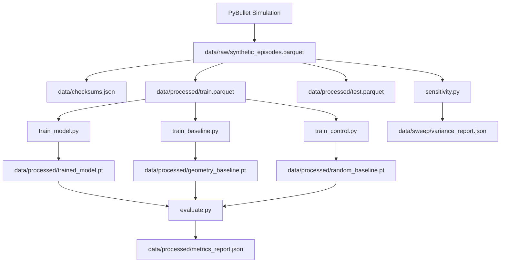

# Data Model: llmXive follow-up: extending "Translation as a Bridging Action"

## 1. Entity Overview
- **ManipulationEpisode** – core record (translation trajectory, object bounds, stability label).  
- **StabilityMetric** – intermediate values (`tipping_angle`, `slippage_distance`) used only for labeling; **not stored in the final processed datasets**.  
- **PredictionResult** – model predictions and evaluation metrics.

## 2. Schemas (refer to `specs/001-llmxive-follow-up/contracts/`)

### Raw Dataset (`synthetic_episodes.parquet`)
| Column | Type | Description | Constraints |
|--------|------|-------------|-------------|
| `episode_id` | int64 | Unique episode identifier | Primary key |
| `geometry_id` | string | Geometry identifier (required for disjoint split) | Non‑null |
| `translation_sequence` | list[float] | Flattened (x,y,z) translation vectors (seq_len × 3) | Fixed length, meters |
| `initial_bounds` | list[float] | Bounding box `[min_x, min_y, min_z, max_x, max_y, max_z]` | Length = 6 |
| `tipping_angle` | float32 | Max tipping angle (°) | Used for labeling |
| `slippage_distance` | float32 | Max slippage (m) | Used for labeling |
| `stability_label` | int8 | 1 = success, 0 = failure | Derived via thresholds |
| `timestamp` | string | ISO‑8601 generation time | For reproducibility |
| `mass_distribution` | float32 | **(Retained only for internal analysis; **not** part of processed inputs or model features)** |
| `friction_coeff` | float32 | **(Retained only for internal analysis; **not** part of processed inputs or model features)** |

**Forbidden columns**: `rotation_quaternion`, `joint_torque`, `force_sensor`, `angular_velocity` (Constitution VII).

### Processed Datasets (`train.parquet`, `test.parquet`)
| Column | Type | Description |
|--------|------|-------------|
| `episode_id` | int64 | From raw |
| `geometry_id` | string | From raw |
| `translation_sequence` | list[float] | Model input (translation only) |
| `initial_bounds` | list[float] | Geometry baseline input |
| `stability_label` | int8 | Target |

*Note*: `mass_distribution` and `friction_coeff` are **excluded** from these processed files to avoid hidden confounds and to ensure the translation‑only signal integrity.

### Model Artifacts
- `trained_model.pt` – PyTorch state dict (Transformer).  
- `geometry_baseline.pt` – MLP state dict.  
- `random_baseline.pt` – Shuffled‑translation model state dict.  

Each model is accompanied by a JSON metadata file (`model_meta.json`) containing `parameter_count`, `architecture`, and training hyper‑parameters (conforms to `contracts/model.schema.yaml`).

### Metrics Report (`metrics_report.json`)
Conforms to `contracts/report.schema.yaml`. Contains:
- accuracies (main, baselines, control)  
- AUC‑ROC, confusion matrix, McNemar p‑values  
- `accuracy_improvement` (main – baseline) **and** separate fields for geometry and random improvements (optional)  
- `sensitivity_variance` (noise sweep)  
- runtime & peak RAM  
- `associational_framing: true`  

## 3. Data Flow

All steps are validated against the appropriate JSON schemas before proceeding.

---

